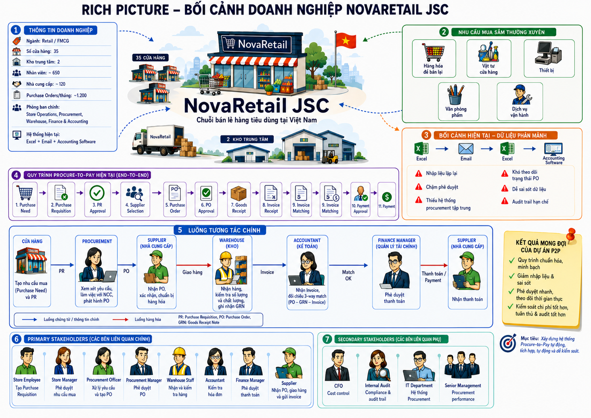

# 01 — Bối cảnh nghiệp vụ

## Mục đích và kết quả chính

Phần này xác định vấn đề cần giải quyết, mục tiêu và phạm vi của nghiên cứu tình huống NovaRetail JSC. Thông tin mua hàng nằm rải rác trong bảng tính, email và phần mềm kế toán, nên các bộ phận phải chuyển thông tin và theo dõi công việc qua nhiều công cụ.

NovaRetail JSC là doanh nghiệp giả lập với 35 cửa hàng, 2 kho trung tâm, khoảng 650 nhân viên, khoảng 120 nhà cung cấp và khoảng 1.200 đơn đặt hàng (Purchase Order — PO)/tháng. Các số liệu nghiệp vụ này là **dữ liệu tổng hợp**.

Bối cảnh doanh nghiệp có cả nhu cầu dịch vụ vận hành. Phạm vi nghiên cứu quy trình mua hàng đến thanh toán (Procure-to-Pay — P2P) chỉ gồm hàng hóa hữu hình và dừng ở phê duyệt đề nghị thanh toán.

## Đọc sâu

| Tài liệu | Nội dung |
| --- | --- |
| [Phát biểu vấn đề](./problem-statement.md) | Hiện trạng, bảy điểm bất cập và tác động nghiệp vụ. |
| [Mục tiêu dự án](./project-objectives.md) | OBJ-01–OBJ-05, các chỉ số hiệu quả (KPI) với mục tiêu giả định và các lựa chọn đo lường còn mở. |
| [Phạm vi](./scope.md) | Ranh giới, loại trừ, giả định và các giới hạn đường cơ sở. |

## Bức tranh tổng thể

> **Chú giải phạm vi cho bức tranh tổng thể (ảnh raster):** NovaRetail JSC và các số liệu 35 cửa hàng, 2 kho, khoảng 650 nhân viên, khoảng 120 nhà cung cấp và 1.200 PO/tháng đều là **giả lập**. Hình mô tả bối cảnh doanh nghiệp rộng hơn nghiên cứu tình huống: nhu cầu **dịch vụ vận hành** và các bước **thanh toán ngân hàng (bank payment) / nhà cung cấp (Supplier) nhận tiền** nằm **ngoài phạm vi** đường cơ sở hiện hành. Quy trình thuộc phạm vi dừng tại **Đề nghị thanh toán đã được phê duyệt (Payment Request Approved)**; nhãn “Payment Approval” trong ảnh là phê duyệt đề nghị thanh toán, không có nghĩa là **đã thanh toán (Paid)**. Dòng số 9 “Invoice Matching” (đối chiếu hóa đơn) xuất hiện hai lần là nhãn bị lặp, **không phải hai lần đối chiếu bắt buộc**. Kho mã chỉ có ảnh raster, không có nguồn chỉnh sửa. Ảnh gốc chưa được sửa và chưa được Việt hóa hoàn toàn; chú giải này hiệu chỉnh cách đọc ảnh.

Tiếp theo: [02 — Phân tích các bên liên quan](../02-stakeholder-analysis/README.md).
