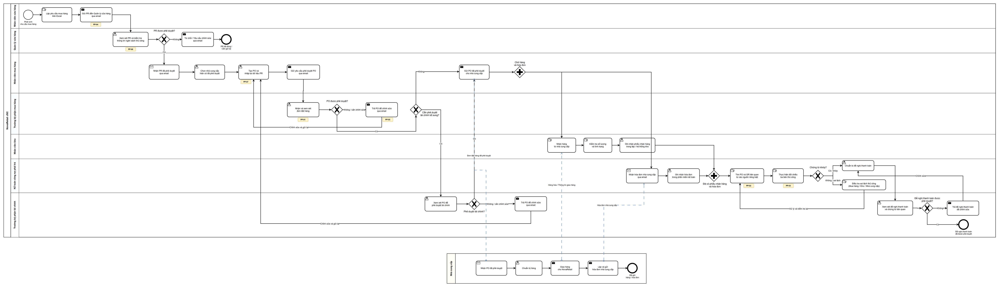

# Phân tích quy trình từ mua hàng đến thanh toán hiện tại (As-Is)

> **Điều hướng giai đoạn:** Mục đích: mô hình hóa quy trình hiện tại và phân tích vấn đề. Nội dung: BPMN As-Is, điểm bất cập và nguyên nhân gốc rễ. Tiếp theo: [04 — Thiết kế To-Be](../04-to-be-design/README.md).

## 1. Mục đích phân tích

Mô hình hóa quy trình mua hàng đến thanh toán (P2P) hiện tại để xác định bàn giao thủ công, điểm bất cập, điểm nghẽn và khoảng trống kiểm soát làm đầu vào cho To-Be. Đây là mô hình giả lập, giữ nguyên đặc điểm dùng bảng tính, email và đối chiếu thủ công của hiện trạng.

**Đọc theo nhu cầu:** [BPMN](#4-bpmn-quy-trình-as-is) · [Diễn giải quy trình](#5-diễn-giải-từng-bước-quy-trình-hiện-tại) · [Điểm nghẽn](#8-phân-tích-điểm-nghẽn).

| Tài liệu chi tiết | Nội dung chính |
| --- | --- |
| [Phân tích điểm bất cập](./pain-point-analysis.md) | PP-01–PP-07, quan sát, tác động, bên bị ảnh hưởng, quan hệ và ưu tiên. |
| [Phân tích nguyên nhân gốc rễ](./root-cause-analysis.md) | RC-01–RC-03, chuỗi câu hỏi tại sao, yếu tố góp phần và hướng cải tiến. |

## 2. Ranh giới quy trình

Phân tích bao phủ quy trình P2P từ khi xác định nhu cầu mua hàng đến khi đề nghị thanh toán liên quan được phê duyệt.

### Bắt đầu quy trình

Quy trình bắt đầu khi Nhân viên cửa hàng hoặc người yêu cầu được cấp quyền xác định nhu cầu mua hàng hóa, vật tư, thiết bị hoặc dịch vụ vận hành.

### Kết thúc quy trình

Quy trình kết thúc khi:

* hóa đơn nhà cung cấp đã được xem xét;
* đối chiếu ba bên đã hoàn tất;
* các ngoại lệ liên quan đã được xử lý;
* đề nghị thanh toán đã được phê duyệt.

Thực hiện thanh toán thực tế qua hệ thống ngân hàng nằm ngoài phạm vi quy trình này.

### Luồng tổng quan

PR → phê duyệt PR → lựa chọn nhà cung cấp → lập/phê duyệt PO → nhà cung cấp giao hàng → GR và hóa đơn → đối chiếu, xử lý ngoại lệ → phê duyệt đề nghị thanh toán. Trình tự và nhánh được thể hiện trong BPMN bên dưới.

---

## 3. Các bên tham gia quy trình

| Bên tham gia | Vai trò trong quy trình As-Is |
| -------------------------- | ----------------------------------------------------------------------------------- |
| Người yêu cầu / Nhân viên cửa hàng | Xác định nhu cầu mua hàng và lập yêu cầu mua hàng (Purchase Requisition — PR) |
| Quản lý cửa hàng | Xem xét và phê duyệt hoặc từ chối yêu cầu mua hàng |
| Nhân viên mua hàng | Xem xét PR đã phê duyệt, chọn nhà cung cấp đã được phê duyệt và lập đơn đặt hàng (Purchase Order — PO) |
| Trưởng bộ phận mua hàng | Xem xét đơn đặt hàng và thực hiện phê duyệt mua hàng |
| Nhân viên kho | Nhận hàng và ghi nhận thông tin phiếu nhận hàng (Goods Receipt — GR) |
| Kế toán công nợ phải trả (AP) | Nhận hóa đơn nhà cung cấp và thực hiện đối chiếu ba bên |
| Trưởng bộ phận tài chính | Thực hiện kiểm soát tài chính bổ sung và phê duyệt đề nghị thanh toán |
| Nhà cung cấp | Nhận đơn đặt hàng, giao hàng và gửi hóa đơn |

Nhà cung cấp được mô hình hóa là bên tham gia bên ngoài vì hoạt động ngoài NovaRetail.

---

## 4. BPMN quy trình As-Is



[Mở PNG đầy đủ](../assets/diagrams/exports/as-is/p2p-as-is.png) · [Nguồn Draw.io](../assets/diagrams/sources/as-is/p2p-as-is.drawio) · [Danh mục nguồn và lịch sử kiểm tra](../assets/diagrams/sources/README.md).

[URL trình biên tập bên ngoài](../assets/diagrams/editable-references/as-is-p2p-diagram-url.txt) được giữ làm tham chiếu lịch sử.

Mô hình BPMN thể hiện quy trình hiện tại, không phải giải pháp tương lai được đề xuất.

Ví dụ:

* Yêu cầu mua hàng được lập trên bảng tính.
* Hoạt động phê duyệt phụ thuộc vào trao đổi email.
* Dữ liệu mua hàng được lưu giữ trong nhiều tệp và hệ thống.
* Dữ liệu đơn đặt hàng có thể phải nhập lại từ yêu cầu mua hàng gốc.
* Thông tin phiếu nhận hàng và hóa đơn do các bộ phận nghiệp vụ khác nhau lưu giữ.
* Đối chiếu ba bên được thực hiện thủ công.
* Trạng thái giao dịch và lịch sử phê duyệt không có sẵn tập trung.

Các đặc điểm này được chủ ý giữ lại vì là cơ sở của phân tích As-Is.

---

## 5. Diễn giải từng bước quy trình hiện tại

### 5.1 Lập yêu cầu mua hàng

Quy trình bắt đầu khi Nhân viên cửa hàng hoặc người yêu cầu xác định nhu cầu mua hàng.

Người yêu cầu lập yêu cầu mua hàng bằng Excel và ghi nhận các thông tin như:

* hàng hóa hoặc dịch vụ được yêu cầu;
* số lượng;
* giá ước tính;
* ngày cần hàng;
* lý do mua hàng;
* cửa hàng hoặc bộ phận yêu cầu.

Sau đó, yêu cầu mua hàng được gửi đến Quản lý cửa hàng qua email.

**Quan sát:**
Giao dịch mua hàng không bắt đầu trong luồng công việc tập trung. Thông tin ban đầu được lưu trên bảng tính và trao đổi qua email.

**Các điểm bất cập liên quan:** PP-02, PP-04, PP-07.

---

### 5.2 Phê duyệt yêu cầu mua hàng

Quản lý cửa hàng nhận yêu cầu mua hàng qua email và xem xét yêu cầu.

Thông tin ngân sách có thể cần được kiểm tra riêng vì thông tin mua hàng và ngân sách không được quản lý qua một quy trình duy nhất.

Sau đó, quản lý phê duyệt hoặc từ chối yêu cầu.

Nếu yêu cầu bị từ chối, quy trình hiện tại kết thúc hoặc người yêu cầu có thể phải lập yêu cầu đã chỉnh sửa.

**Quan sát:**
Thông tin phê duyệt được lưu giữ qua trao đổi email, còn kiểm soát ngân sách được thực hiện thủ công và có thể không được áp dụng nhất quán.

**Các điểm bất cập liên quan:** PP-04, PP-05, PP-06.

---

### 5.3 Xử lý mua hàng

Sau khi yêu cầu mua hàng được phê duyệt, Nhân viên mua hàng nhận yêu cầu và xem xét thông tin mua hàng.

Nhân viên mua hàng chọn một nhà cung cấp hiện có đã được phê duyệt và lập đơn đặt hàng tương ứng.

Vì PR gốc và PO được lưu riêng, thông tin trong yêu cầu mua hàng có thể phải nhập lại khi lập đơn đặt hàng.

**Quan sát:**
Thông tin giao dịch hiện có không được tự động tái sử dụng giữa các bước quy trình.

**Các điểm bất cập liên quan:** PP-02, PP-07.

---

### 5.4 Phê duyệt đơn đặt hàng

Nhân viên mua hàng gửi đơn đặt hàng đến Trưởng bộ phận mua hàng để phê duyệt qua email.

Trưởng bộ phận mua hàng xem xét các thông tin như:

* nhà cung cấp;
* mặt hàng;
* số lượng;
* giá;
* tổng giá trị;
* căn cứ mua hàng.

Nếu đơn đặt hàng bị từ chối hoặc cần chỉnh sửa, đơn được trả về Nhân viên mua hàng.

Một số đơn đặt hàng cũng có thể cần phê duyệt tài chính bổ sung tùy quy tắc phê duyệt áp dụng.

**Quan sát:**
Nguồn gây chậm chính không nhất thiết là bản thân việc xem xét, mà là thời gian chờ do phê duyệt qua email và đôn đốc thủ công.

**Các điểm bất cập liên quan:** PP-01, PP-04, PP-05.

---

### 5.5 Nhà cung cấp thực hiện đơn hàng

Sau phê duyệt, Nhân viên mua hàng gửi đơn đặt hàng đến nhà cung cấp đã chọn.

Nhà cung cấp nhận đơn đặt hàng, chuẩn bị hàng được yêu cầu và giao đến NovaRetail.

Nhà cung cấp cũng phát hành hóa đơn tương ứng.

Vì nhà cung cấp nằm ngoài NovaRetail, các tương tác này được biểu diễn bằng luồng thông điệp (Message Flow) trong BPMN.

---

### 5.6 Nhận hàng

Nhân viên kho nhận hàng được giao và so sánh với đơn đặt hàng.

Hoạt động nhận hàng gồm kiểm tra:

* số lượng;
* mặt hàng;
* tình trạng khi giao;
* nhận một phần hoặc toàn bộ.

Sau đó, kho ghi nhận thông tin phiếu nhận hàng.

Thông tin này có thể được lưu riêng với hồ sơ mua hàng và kế toán.

**Quan sát:**
Thông tin phiếu nhận hàng không nhất thiết có sẵn ngay cho bộ phận mua hàng hoặc công nợ phải trả qua hồ sơ giao dịch dùng chung.

**Các điểm bất cập liên quan:** PP-02, PP-04, PP-07.

---

### 5.7 Xử lý hóa đơn nhà cung cấp

Nhà cung cấp gửi hóa đơn đến NovaRetail.

Kế toán công nợ phải trả nhận hóa đơn và xác định đơn đặt hàng, phiếu nhận hàng liên quan.

Vì các chứng từ có thể được lưu ở nhiều nguồn, Kế toán công nợ phải trả có thể phải tìm và thu thập thông tin giao dịch liên quan thủ công.

**Quan sát:**
Xử lý hóa đơn phụ thuộc vào thông tin do các bộ phận và hệ thống khác nhau lưu giữ.

**Các điểm bất cập liên quan:** PP-02, PP-03.

---

### 5.8 Đối chiếu ba bên thủ công

Kế toán công nợ phải trả so sánh thủ công:

```text
Đơn đặt hàng
      +
Phiếu nhận hàng
      +
Hóa đơn nhà cung cấp
```

Việc so sánh có thể gồm:

* nhà cung cấp;
* mặt hàng;
* số lượng;
* đơn giá;
* số tiền hóa đơn.

Nếu thông tin khớp, hóa đơn có thể tiếp tục đến phê duyệt thanh toán.

Nếu phát hiện sai lệch, cần điều tra thêm.

**Quan sát:**
Đối chiếu ba bên phụ thuộc nhiều vào thu thập và so sánh chứng từ thủ công.

**Điểm bất cập liên quan:** PP-03.

---

### 5.9 Xử lý ngoại lệ

Khi đơn đặt hàng, phiếu nhận hàng và hóa đơn nhà cung cấp không khớp, Kế toán công nợ phải trả điều tra sai lệch.

Tùy vấn đề, kế toán có thể cần liên hệ:

* Bộ phận mua hàng;
* Kho;
* Nhà cung cấp.

Trao đổi có thể qua email, điện thoại hoặc kiểm tra thủ công.

Sau khi sai lệch được khắc phục, các chứng từ được xem xét lại.

**Quan sát:**
Xử lý ngoại lệ phụ thuộc nhiều vào phối hợp thủ công giữa nhiều bên.

Điều này không tạo điểm bất cập riêng trong nghiên cứu tình huống, nhưng làm rõ thêm PP-02 và PP-03.

---

### 5.10 Phê duyệt thanh toán

Sau khi hóa đơn được kiểm tra đạt, Kế toán công nợ phải trả lập đề nghị thanh toán (Payment Request).

Trưởng bộ phận tài chính xem xét đề nghị thanh toán và thông tin hỗ trợ liên quan.

Nếu được phê duyệt, giao dịch mua hàng đạt điểm kết thúc của quy trình được phân tích trong dự án.

Nếu yêu cầu bị từ chối, yêu cầu được trả về để chỉnh sửa hoặc xem xét thêm.

**Kết thúc quy trình:**
Đề nghị thanh toán đã được phê duyệt.

---

## 6. Phân tích điểm bất cập

Bảy điểm bất cập PP-01–PP-07 được tổng hợp và phân tích tại [tài liệu điểm bất cập](./pain-point-analysis.md#2-tổng-hợp-điểm-bất-cập). Các tham chiếu PP ở từng bước phía trên nối quan sát quy trình với phân tích chi tiết này.

## 7. Phân nhóm điểm bất cập

Ba nhóm là hiệu quả quy trình, dữ liệu/khả năng theo dõi và kiểm soát/quản trị. Xem [bảng phân nhóm](./pain-point-analysis.md#2-tổng-hợp-điểm-bất-cập), [quan hệ giữa các vấn đề](./pain-point-analysis.md#4-mối-liên-hệ-giữa-các-điểm-bất-cập) và [ưu tiên](./pain-point-analysis.md#5-ưu-tiên-các-điểm-bất-cập).

---

## 8. Phân tích điểm nghẽn

Không phải mọi điểm bất cập đều được coi là điểm nghẽn quy trình.

Phân tích As-Is xác định ba điểm nghẽn chính có khả năng làm tăng thời gian chu trình và khối lượng công việc thủ công nhiều nhất.

### 8.1 Điểm nghẽn 1 — Thời gian chờ phê duyệt đơn đặt hàng

Quy trình phê duyệt PO dựa vào trao đổi email.

```text
PO đã được lập
    ↓
Email phê duyệt đã gửi
    ↓
Chờ người phê duyệt
    ↓
Quản lý xem xét PO
    ↓
Quyết định phê duyệt
```

Công việc thực tế để xem xét đơn đặt hàng có thể mất tương đối ít thời gian.

Tuy nhiên, yêu cầu có thể nằm trong hàng đợi email của người phê duyệt trước khi được xem xét.

Vì vậy, điểm nghẽn chính là **thời gian chờ từ lúc gửi đến lúc phê duyệt**, không phải bản thân việc xem xét.

**Điểm bất cập liên quan:** PP-01.

---

### 8.2 Điểm nghẽn 2 — Bàn giao thông tin thủ công

Thông tin mua hàng luân chuyển giữa nhiều bộ phận và công cụ.

```text
Yêu cầu mua hàng
        ↓
Đơn đặt hàng
        ↓
Hồ sơ kho
        ↓
Hồ sơ kế toán
```

Mỗi lần bàn giao có thể cần:

* nhập dữ liệu thủ công;
* chuyển tệp;
* trao đổi email;
* xác minh thủ công.

Các lần bàn giao này làm tăng:

* thời gian xử lý;
* công sức phối hợp;
* rủi ro thông tin không nhất quán;
* rủi ro lỗi nhập liệu.

**Các điểm bất cập liên quan:** PP-02 và PP-07.

---

### 8.3 Điểm nghẽn 3 — Đối chiếu hóa đơn thủ công

Bộ phận công nợ phải trả phải thu thập thông tin từ nhiều nguồn trước khi hóa đơn có thể được phê duyệt.

```text
Tìm đơn đặt hàng
        +
Tìm phiếu nhận hàng
        +
Xem xét hóa đơn nhà cung cấp
        ↓
So sánh thủ công
        ↓
Điều tra sai lệch
```

Khi khối lượng giao dịch tăng, hoạt động này có thể trở thành hạn chế xử lý đáng kể đối với bộ phận công nợ phải trả.

**Điểm bất cập liên quan:** PP-03.

---

## 9. Phân tích nguyên nhân gốc rễ

Phân tích chuyên sâu tập trung vào ba vấn đề có tác động lớn:

| Nguyên nhân | Nội dung và nơi đọc chi tiết |
| --- | --- |
| RC-01 | [Thiếu luồng phê duyệt PO chuẩn hóa và tập trung](./root-cause-analysis.md#3-rc-01--chậm-phê-duyệt-đơn-đặt-hàng). |
| RC-02 | [Thiếu luồng dữ liệu mua hàng tích hợp](./root-cause-analysis.md#4-rc-02--dữ-liệu-mua-hàng-phân-tán-và-nhập-lặp-lại). |
| RC-03 | [Thiếu dữ liệu giao dịch tích hợp và khả năng đối chiếu tự động](./root-cause-analysis.md#5-rc-03--đối-chiếu-ba-bên-thủ-công). |

Tài liệu nguyên nhân gốc rễ giữ đầy đủ chuỗi phân tích, yếu tố góp phần, hệ quả và hướng cải tiến.

---

## 10. Các phát hiện chính

- Quy trình phân tán tạo nhiều bàn giao thủ công và khoảng trống thông tin.
- Lập PR, phê duyệt, nhập PO, kiểm tra ngân sách, thu thập chứng từ, đối chiếu và xử lý ngoại lệ phụ thuộc nhiều vào thao tác thủ công.
- Khó xác định trạng thái, người xử lý tiếp theo, thời gian chờ và lịch sử phê duyệt; bằng chứng kiểm soát ngân sách/kiểm toán thiếu tập trung.
- Khi khối lượng mua hàng tăng, công việc tìm chứng từ, nhập lại và đối chiếu thủ công tạo rủi ro mở rộng.

---

## 11. Hướng cải tiến

Các phát hiện xác định hướng cải tiến cho To-Be; đây chưa phải giải pháp cuối cùng.

Các hướng cải tiến chính gồm:

* giảm bàn giao thủ công không cần thiết;
* chuẩn hóa hoạt động phê duyệt;
* cải thiện tính nhất quán dữ liệu mua hàng;
* cải thiện khả năng theo dõi trạng thái PR và PO;
* tăng cường kiểm soát ngân sách và kiểm toán;
* giảm nhập dữ liệu lặp lại;
* giảm đối chiếu hóa đơn thủ công;
* cung cấp cách xử lý ngoại lệ có cấu trúc.

Các phát hiện này sẽ được dùng làm đầu vào trực tiếp cho thiết kế quy trình P2P To-Be.
