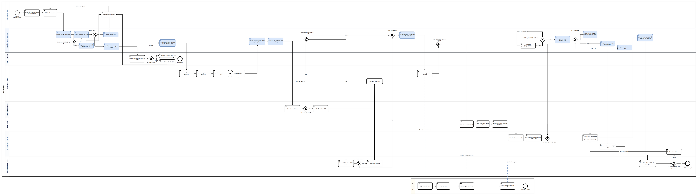

# Thiết kế quy trình từ mua hàng đến thanh toán tương lai (To-Be)

## Tổng quan

Phần này đề xuất cách xử lý các vấn đề của quy trình mua hàng đến thanh toán (Procure-to-Pay — P2P) hiện tại. Sơ đồ To-Be mô tả thứ tự xử lý, người quyết định và cách hệ thống kiểm tra ngân sách, chuyển phê duyệt, liên kết chứng từ và đối chiếu ba bên. Các quyết định nghiệp vụ vẫn do người có thẩm quyền thực hiện.

Phạm vi chỉ gồm hàng hóa hữu hình từ lập yêu cầu mua hàng (Purchase Requisition — PR) đến **Đề nghị thanh toán đã được phê duyệt**; thực hiện thanh toán ngân hàng nằm ngoài phạm vi.

| Đọc theo nhu cầu | Nội dung |
| --- | --- |
| [BPMN tổng quan](#5-mô-hình-bpmn-to-be) | Xem toàn quy trình, mở PNG đầy đủ hoặc nguồn Draw.io. |
| [Diễn giải quy trình](#6-diễn-giải-từng-bước-quy-trình-to-be) | Thứ tự bước, quyết định, nhánh trả về và ngoại lệ. |
| [So sánh As-Is/To-Be](./as-is-to-be-comparison.md) | Thay đổi từng khâu, trách nhiệm thủ công/tự động và điều kiện phụ thuộc. |
| [Bản đồ cải tiến](./improvement-map.md) | Quan hệ vấn đề → nguyên nhân → cải tiến → mục tiêu → quy tắc. |
| [Quy tắc nghiệp vụ](./business-rules.md) | Nội dung chi tiết BR-01–BR-27. |

## 1. Mục tiêu thiết kế quy trình

Quy trình To-Be hướng tới giảm thời gian chờ phê duyệt, giảm nhập lại dữ liệu và giúp các bộ phận theo dõi chứng từ, quyết định và ngoại lệ. Năm mục tiêu dự án bên dưới nêu các hướng cải tiến này:

| ID | Mục tiêu nghiệp vụ |
| ------ | --------------------------------------------------- |
| OBJ-01 | Rút ngắn chu trình phê duyệt đơn đặt hàng |
| OBJ-02 | Giảm nhập dữ liệu thủ công lặp lại |
| OBJ-03 | Cải thiện khả năng theo dõi mua hàng và tính nhất quán dữ liệu |
| OBJ-04 | Tăng cường kiểm soát mua hàng và hóa đơn |
| OBJ-05 | Cải thiện khả năng truy vết giao dịch |

Quy trình To-Be chỉ đưa vào cải tiến có thể truy vết tới vấn đề nghiệp vụ, nguyên nhân gốc rễ hoặc mục tiêu dự án đã xác định.

---

## 2. Nguyên tắc thiết kế

Năm nguyên tắc được dùng khi thiết kế quy trình tương lai.

### 2.1 Chuẩn hóa luồng công việc

Hoạt động phê duyệt và giao dịch nên theo luồng công việc được xác định thay vì phụ thuộc trao đổi email riêng lẻ và đôn đốc thủ công.

Hệ thống chuyển chứng từ đến người xử lý phù hợp; người có thẩm quyền quyết định phê duyệt.

---

### 2.2 Tái sử dụng dữ liệu giao dịch hiện có

Thông tin đã ghi nhận ở bước trước nên được tái sử dụng khi phù hợp.

Điều này giảm nhập liệu không cần thiết và giảm rủi ro giá trị không nhất quán giữa các chứng từ liên quan.

---

### 2.3 Tự động hóa hoạt động theo quy tắc

Hoạt động có quy tắc rõ ràng và lặp lại được có thể được tự động hóa.

Ví dụ gồm:

* kiểm tra trường bắt buộc;
* kiểm tra ngân sách;
* chuyển phê duyệt;
* cập nhật trạng thái giao dịch;
* đối chiếu ba bên;
* tạo ngoại lệ.

Hoạt động cần phán đoán nghiệp vụ vẫn do con người chịu trách nhiệm.

---

### 2.4 Tích hợp kiểm soát nghiệp vụ vào quy trình

Kiểm soát quan trọng nên là một phần luồng mua hàng thông thường, không phải kiểm tra tùy chọn hoặc áp dụng thủ công.

Các điểm kiểm soát chính gồm kiểm tra ngân sách, phê duyệt PR/PO, đối chiếu ba bên và phê duyệt đề nghị thanh toán.

---

### 2.5 Cải thiện khả năng theo dõi và truy vết

Quy trình tương lai nên lưu các thông tin cần để theo dõi giao dịch và xem lại quyết định, có thể gồm:

* trạng thái giao dịch hiện tại;
* người dùng chịu trách nhiệm;
* PR, PO, GR và hóa đơn liên quan;
* quyết định phê duyệt;
* dấu thời gian hành động;
* lịch sử giao dịch.

Những thông tin này giúp người được cấp quyền theo dõi công việc và kiểm tra lịch sử giao dịch.

---

## 3. Ranh giới quy trình

### Sự kiện bắt đầu

Quy trình bắt đầu khi Nhân viên cửa hàng hoặc người yêu cầu được cấp quyền xác định nhu cầu mua hàng và lập yêu cầu mua hàng.

### Sự kiện kết thúc

Luồng được mô hình hóa kết thúc khi đề nghị thanh toán liên quan đã được xem xét và phê duyệt. Điều này không có nghĩa đã thực hiện thanh toán hoặc Nhà cung cấp đã nhận tiền.

### Quy trình tổng quan

PR → kiểm tra thông tin/ngân sách → phê duyệt PR → lập/phê duyệt/phát hành PO → nhận hàng và hóa đơn → đối chiếu/xử lý ngoại lệ → chuẩn bị, gửi và phê duyệt đề nghị thanh toán. BPMN bên dưới thể hiện các nhánh và vòng lặp; thanh toán ngân hàng nằm ngoài phạm vi.

---

## 4. Các bên tham gia quy trình

Quy trình To-Be gồm cả bên tham gia là con người và hoạt động hệ thống tự động.

| Bên tham gia | Trách nhiệm |
| ----------------------------- | -------------------------------------------------------------------------------------------------- |
| Nhân viên cửa hàng / Người yêu cầu | Lập, gửi và chỉnh sửa yêu cầu mua hàng |
| Hệ thống quản lý mua hàng | Thực hiện kiểm tra, chuyển xử lý, liên kết giao dịch, đối chiếu, cập nhật trạng thái và kiểm soát luồng công việc |
| Quản lý cửa hàng | Xem xét và phê duyệt nhu cầu nghiệp vụ được thể hiện trong PR |
| Nhân viên mua hàng | Xem xét PR đã phê duyệt, chọn nhà cung cấp đã phê duyệt, lập và duy trì đơn đặt hàng |
| Trưởng bộ phận mua hàng | Xem xét đơn đặt hàng từ góc độ kiểm soát mua hàng |
| Nhân viên kho | Nhận hàng và ghi phiếu nhận hàng theo PO liên quan |
| Kế toán công nợ phải trả (AP) | Ghi hóa đơn, xử lý ngoại lệ đối chiếu và chuẩn bị đề nghị thanh toán |
| Trưởng bộ phận tài chính | Thực hiện phê duyệt tài chính bắt buộc và phê duyệt đề nghị thanh toán |
| Nhà cung cấp | Nhận đơn đặt hàng đã phê duyệt, giao hàng và phát hành hóa đơn |

### Bên tham gia bên ngoài

**Nhà cung cấp** vẫn nằm ngoài ranh giới hệ thống nội bộ NovaRetail.

Dự án không bao gồm cổng thông tin nhà cung cấp. Vì vậy, trao đổi với nhà cung cấp được thể hiện là tương tác bên ngoài với quy trình mua hàng nội bộ.

---

## 5. Mô hình BPMN To-Be



[Mở PNG đầy đủ để phóng to](../assets/diagrams/exports/to-be/p2p-to-be.png) · [Mở nguồn Draw.io tương ứng](../assets/diagrams/sources/to-be/p2p-to-be.drawio).

Ảnh xem trước phía trên giúp theo dõi toàn quy trình; mở ảnh đầy đủ để đọc nhãn của sơ đồ rộng. Nguồn, trang tương ứng và lịch sử kiểm tra được ghi tại [danh mục nguồn sơ đồ](../assets/diagrams/sources/README.md); [URL trình biên tập bên ngoài](../assets/diagrams/editable-references/to-be-p2p-diagram-url.txt) là tham chiếu lịch sử.

Nhân viên kho ghi nhận phiếu nhận hàng (GR), còn Kế toán công nợ phải trả ghi nhận hóa đơn. Sau khi cả hai nhánh hoàn tất ghi nhận, hệ thống kiểm tra thông tin PO, GR và hóa đơn bắt buộc; nếu thiếu thì chờ bổ sung, khi đủ mới chạy đối chiếu ba bên. Khi đối chiếu không đạt, ngoại lệ vẫn mở; chỉ đối chiếu lại đạt mới xác nhận ngoại lệ đã xử lý.

Mô hình BPMN phân biệt:

* hoạt động con người;
* hoạt động hệ thống tự động;
* quyết định phê duyệt;
* đường ngoại lệ;
* tương tác nhà cung cấp bên ngoài.

**Hệ thống quản lý mua hàng** được thể hiện riêng vì nhiều hoạt động tương lai được thực hiện tự động thay vì bởi một nhân viên cụ thể.

---

## 6. Diễn giải từng bước quy trình To-Be

### 6.1 Lập yêu cầu mua hàng

Quy trình bắt đầu khi Nhân viên cửa hàng xác định nhu cầu mua hàng.

Người yêu cầu lập yêu cầu mua hàng (Purchase Requisition — PR) trực tiếp trong Hệ thống quản lý mua hàng.

Thông tin điển hình gồm:

* hàng hóa hữu hình;
* số lượng yêu cầu;
* giá ước tính;
* ngày cần hàng;
* lý do mua hàng;
* cửa hàng hoặc bộ phận;
* trung tâm chi phí.

Sau khi hoàn thiện thông tin bắt buộc, người yêu cầu gửi PR.

#### Cải tiến

Giao dịch mua hàng được tạo trong luồng công việc tập trung thay vì bắt đầu bằng tệp Excel phân phối qua email.

**Các điểm bất cập liên quan:** PP-02, PP-04, PP-07.

---

### 6.2 Kiểm tra thông tin bắt buộc

Sau khi gửi, hệ thống kiểm tra yêu cầu mua hàng có chứa thông tin bắt buộc hay không.

Ví dụ có thể gồm:

* trường bắt buộc;
* người yêu cầu hợp lệ;
* cửa hàng hoặc bộ phận;
* trung tâm chi phí;
* giá trị mua ước tính.

Yêu cầu chưa đầy đủ được trả về người yêu cầu để chỉnh sửa trước khi tiếp tục.

#### Cải tiến

Yêu cầu thiếu hoặc không hợp lệ có thể được nhận diện sớm hơn trong quy trình, thay vì được người dùng ở bước sau phát hiện thủ công.

---

### 6.3 Kiểm tra ngân sách

Sau khi thông tin bắt buộc được kiểm tra đạt, hệ thống kiểm tra ngân sách khả dụng gắn với yêu cầu.

#### Nếu có đủ ngân sách

Yêu cầu tiếp tục đến phê duyệt nghiệp vụ.

#### Nếu không có đủ ngân sách

```text
Không có đủ ngân sách
        ↓
Trả PR
        ↓
Người yêu cầu chỉnh sửa PR
        ↓
Gửi lại
```

Dự án giả định thông tin ngân sách có sẵn cho quy trình mua hàng.

Giải pháp mua hàng không lập hoặc quản lý ngân sách doanh nghiệp của NovaRetail.

#### Cải tiến

Kiểm tra ngân sách trở thành điểm kiểm soát nhất quán trước phê duyệt PR.

**Điểm bất cập liên quan:** PP-06.
**Mục tiêu liên quan:** OBJ-04.

---

### 6.4 Phê duyệt yêu cầu mua hàng

Sau khi kiểm tra đạt, Quản lý cửa hàng xem xét yêu cầu mua hàng.

Thông tin liên quan có thể gồm:

* người yêu cầu;
* mặt hàng yêu cầu;
* số lượng;
* số tiền ước tính;
* lý do nghiệp vụ;
* ngày cần hàng;
* kết quả kiểm tra ngân sách.

Quản lý cửa hàng quyết định có nên tiếp tục giao dịch mua hay không.

#### Đã phê duyệt

PR được chuyển đến bộ phận mua hàng.

#### Đã từ chối

PR bị từ chối dừng lại, không được mở lại hoặc gửi lại như cùng một PR trong đường cơ sở này.

#### Trả lại để chỉnh sửa

Khi trả lại PR để chỉnh sửa, Quản lý cửa hàng phải ghi lý do. Người yêu cầu được chỉnh sửa và gửi lại; hệ thống kiểm tra lại trường bắt buộc và ngân sách trước khi chuyển PR cho Quản lý cửa hàng xem xét.

Kiểm tra ngân sách và phê duyệt nghiệp vụ được coi là kiểm soát riêng:

```text
Kiểm tra ngân sách
= Tổ chức có khả năng tài chính đáp ứng yêu cầu không?

Phê duyệt nghiệp vụ
= Có nên thực hiện giao dịch mua này không?
```

---

### 6.5 Xử lý mua hàng

Nhân viên mua hàng nhận PR đã phê duyệt và xem xét yêu cầu mua hàng.

Sau đó, nhân viên chọn nhà cung cấp từ danh mục nhà cung cấp hiện có đã được phê duyệt.

Tiếp nhận và đánh giá điều kiện nhà cung cấp không nằm trong quy trình này.

---

### 6.6 Lập đơn đặt hàng

Nhân viên mua hàng lập đơn đặt hàng (Purchase Order — PO) bằng thông tin đã có trong PR đã phê duyệt.

Thông tin có thể tái sử dụng gồm:

* mặt hàng;
* số lượng;
* cửa hàng yêu cầu;
* ngày cần hàng;
* tham chiếu PR.

Nhân viên mua hàng bổ sung thông tin riêng của PO như:

* nhà cung cấp;
* giá cuối cùng;
* thông tin giao hàng;
* điều khoản thương mại.

#### Cải tiến

Tái sử dụng dữ liệu PR phù hợp giúp giảm nhu cầu nhập lại thông tin khi lập PO.

**Điểm bất cập liên quan:** PP-07.
**Mục tiêu liên quan:** OBJ-02.

---

### 6.7 Chuyển phê duyệt đơn đặt hàng

Sau khi PO được gửi, Hệ thống quản lý mua hàng đánh giá quy tắc phê duyệt áp dụng.

Tuyến phê duyệt có thể phụ thuộc các tiêu chí như:

* giá trị mua;
* nhóm mua hàng;
* bộ phận;
* trung tâm chi phí;
* yêu cầu phê duyệt tài chính.

Mô hình BPMN không xác định ngưỡng tiền phê duyệt cụ thể.

Tiêu chí phê duyệt chi tiết được duy trì riêng trong:

[`business-rules.md`](./business-rules.md)

---

### 6.8 Phê duyệt mua hàng

Trưởng bộ phận mua hàng xem xét đơn đặt hàng từ góc độ kiểm soát mua hàng.

Việc xem xét có thể gồm:

* tham chiếu PR đã phê duyệt;
* nhà cung cấp;
* mặt hàng;
* số lượng;
* giá;
* tổng giá trị;
* điều khoản thương mại.

#### Nếu cần thay đổi

```text
Yêu cầu thay đổi
      ↓
Nhân viên mua hàng
Chỉnh sửa PO
      ↓
Gửi lại PO
```

Giao dịch đã chỉnh sửa quay lại luồng phê duyệt.

#### Nếu được phê duyệt

Quy trình xác định có cần phê duyệt tài chính bổ sung hay không.

---

### 6.9 Phê duyệt tài chính có điều kiện

Mọi PO trước hết cần Trưởng bộ phận mua hàng phê duyệt. Phê duyệt bổ sung của Trưởng bộ phận tài chính chỉ áp dụng khi quy tắc nghiệp vụ yêu cầu; phê duyệt tài chính không thay phê duyệt mua hàng. CFO không phải người phê duyệt PO vận hành.

Nếu Trưởng bộ phận tài chính yêu cầu thay đổi, PO được trả về để chỉnh sửa và gửi lại.

Khi mọi phê duyệt bắt buộc hoàn tất, đơn đặt hàng trở thành đã phê duyệt đầy đủ.

#### Quyết định thiết kế

Ngưỡng tiền chính xác được chủ ý chưa xác định trong mô hình BPMN.

Điều này giữ mô hình quy trình ổn định, đồng thời cho phép duy trì ngưỡng phê duyệt dưới dạng quy tắc nghiệp vụ có thể cấu hình.

---

### 6.10 Phát hành đơn đặt hàng

Sau khi hoàn tất mọi phê duyệt bắt buộc, đơn đặt hàng được hoàn tất và phát hành cho Nhà cung cấp.

Hệ thống duy trì trạng thái giao dịch và lịch sử phê duyệt.

---

### 6.11 Nhà cung cấp thực hiện đơn hàng

Nhà cung cấp nhận đơn đặt hàng đã phê duyệt.

Sau đó, Nhà cung cấp:

1. chuẩn bị hàng được yêu cầu;
2. giao hàng đến NovaRetail;
3. phát hành hóa đơn nhà cung cấp tương ứng.

Vì Nhà cung cấp nằm ngoài NovaRetail, trao đổi giữa Nhà cung cấp và NovaRetail được thể hiện bằng luồng thông điệp (Message Flow) BPMN.

---

### 6.12 Nhận hàng

Nhân viên kho nhận hàng được giao và kiểm tra lô hàng.

Kho kiểm tra thông tin như:

* mặt hàng;
* số lượng;
* tình trạng vật lý;
* đơn đặt hàng liên quan.

Phiếu nhận hàng (Goods Receipt — GR) được ghi theo PO tương ứng.

```text
PO-001
   │
   └── GR-001
```

#### Cải tiến

Phiếu nhận hàng gắn trực tiếp với giao dịch mua hàng thay vì chỉ tồn tại như hồ sơ kho độc lập.

---

### 6.13 Xử lý hóa đơn nhà cung cấp

Kế toán công nợ phải trả nhận và ghi hóa đơn nhà cung cấp.

Thông tin điển hình có thể gồm:

* số hóa đơn;
* nhà cung cấp;
* tham chiếu PO;
* ngày hóa đơn;
* số tiền hóa đơn.

Hóa đơn được liên kết với đơn đặt hàng tương ứng.

```text
PR-001
   │
   └── PO-001
         ├── GR-001
         └── INV-001
```

#### Cải tiến

Có thể truy xuất chứng từ mua hàng liên quan qua cùng quan hệ giao dịch.

**Điểm bất cập liên quan:** PP-02.
**Mục tiêu liên quan:** OBJ-03.

---

## 7. Đối chiếu ba bên tự động

Khi có đủ chứng từ bắt buộc, hệ thống thực hiện đối chiếu ba bên giữa:

```text
Đơn đặt hàng
      +
Phiếu nhận hàng
      +
Hóa đơn nhà cung cấp
```

Quy trình đối chiếu có thể so sánh:

* nhà cung cấp;
* mặt hàng;
* số lượng;
* đơn giá;
* tổng tiền.

```text
PO + GR + hóa đơn
        ↓
Đối chiếu ba bên tự động
        ↓
Chứng từ khớp?
```

---

### 7.1 Đối chiếu đạt

Nếu chứng từ thỏa mãn quy tắc đối chiếu áp dụng:

```text
Khớp
  ↓
Đánh dấu hóa đơn đã đối chiếu đạt
  ↓
Sẵn sàng xử lý thanh toán
```

Sau đó, Kế toán công nợ phải trả có thể chuẩn bị đề nghị thanh toán.

#### Cải tiến

Giao dịch đủ điều kiện không còn yêu cầu nhân viên AP so sánh thủ công từng PO, phiếu nhận hàng và hóa đơn.

**Điểm bất cập liên quan:** PP-03.
**Mục tiêu liên quan:** OBJ-04.

---

### 7.2 Ngoại lệ đối chiếu

Nếu chứng từ không thỏa mãn quy tắc đối chiếu:

```text
Sai lệch
   ↓
Tạo ngoại lệ đối chiếu
```

Giao dịch được chuyển sang xử lý ngoại lệ có cấu trúc thay vì chỉ xử lý qua trao đổi email hoặc điện thoại thiếu cấu trúc.

---

## 8. Xử lý ngoại lệ

Ngoại lệ đối chiếu có thể gồm:

* sai lệch số lượng;
* sai lệch giá;
* thông tin hóa đơn không chính xác.

Nếu thiếu phiếu nhận hàng hoặc dữ liệu GR bắt buộc phục vụ đối chiếu, giao dịch phải chờ bổ sung trước khi đối chiếu và chưa đủ điều kiện chuẩn bị hoặc gửi đề nghị thanh toán. Chính sách nhận hàng một phần vẫn còn mở theo OD-08.

Kế toán công nợ phải trả xem xét ngoại lệ và phối hợp với bên liên quan khi cần.

Tùy ngoại lệ, Kế toán công nợ phải trả có thể cần thông tin từ:

* Nhân viên mua hàng;
* Nhân viên kho;
* Nhà cung cấp.

Sau chỉnh sửa, đối chiếu được chạy lại. Đối chiếu lại không đạt giữ ngoại lệ mở và chặn chuẩn bị, gửi đề nghị thanh toán; chỉ đối chiếu lại đạt mới ghi nhận đã xử lý và làm hóa đơn đủ điều kiện. Quy trình chỉnh sửa PO đã phê duyệt/đã phát hành hoặc GR đã ghi còn cần xác định và không phải quyền sửa trực tiếp.

#### Cải tiến

Quy trình tương lai chuyển xử lý ngoại lệ từ phối hợp không chính thức thành luồng công việc truy vết được.

---

## 9. Đề nghị thanh toán

Sau khi kết quả đối chiếu hiện hành thỏa mãn quy tắc áp dụng, Kế toán công nợ phải trả được phép chuẩn bị và gửi đề nghị thanh toán (Payment Request). Thiếu dữ liệu hoặc đối chiếu không đạt chặn cả hai hành động. Chỉnh sửa được ghi riêng; chỉ đối chiếu lại đạt mới xác nhận ngoại lệ đã xử lý và khôi phục điều kiện.

Đề nghị thanh toán giữ tham chiếu đến các chứng từ mua hàng liên quan để Trưởng bộ phận tài chính có thể xem căn cứ khi quyết định.

---

## 10. Phê duyệt thanh toán

Hệ thống chuyển đề nghị thanh toán đến Trưởng bộ phận tài chính.

```text
Gửi đề nghị thanh toán
        ↓
Chuyển phê duyệt
        ↓
Trưởng bộ phận tài chính xem xét
        ↓
Thanh toán được phê duyệt?
```

#### Nếu cần thay đổi

```text
Trả đề nghị
      ↓
AP chỉnh sửa
      ↓
Gửi lại
```

#### Nếu được phê duyệt

```text
Đề nghị thanh toán đã được phê duyệt
```

Đây là **sự kiện kết thúc** quy trình P2P được phân tích trong dự án.

Thực hiện thanh toán thực tế qua ngân hàng nằm ngoài phạm vi dự án.

---

## 11. Trạng thái giao dịch và lịch sử kiểm toán

Theo dõi trạng thái và lịch sử kiểm toán được coi là hành vi toàn hệ thống, không phải tác vụ BPMN riêng sau mỗi hoạt động.

Ví dụ dưới đây minh họa cách ghi hành động, người thực hiện và thời điểm của một giao dịch:

```text
PO-001

Đã tạo
Nhân viên mua hàng
09:10

Đã gửi
Nhân viên mua hàng
09:25

Đã phê duyệt mua hàng
Trưởng bộ phận mua hàng
10:05

Đã phê duyệt tài chính
Trưởng bộ phận tài chính
10:40
```

Điều này hỗ trợ khả năng theo dõi vận hành và kiểm toán.

**Các điểm bất cập liên quan:** PP-04 và PP-05.
**Các mục tiêu liên quan:** OBJ-03 và OBJ-05.

---

## 12. Cải tiến quy trình chính

Các thay đổi về lập chứng từ, chuyển phê duyệt, liên kết dữ liệu và đối chiếu được đối chiếu từng khâu tại [So sánh tổng quan](./as-is-to-be-comparison.md#2-so-sánh-tổng-quan). Tài liệu này cũng phân biệt [trách nhiệm thủ công và tự động](./as-is-to-be-comparison.md#22-trách-nhiệm-thủ-công-và-tự-động).

---

## 13. Mức độ bao phủ điểm bất cập

Quy trình tương lai được thiết kế để trực tiếp xử lý bảy điểm bất cập As-Is đã xác định.

| Điểm bất cập | Cải tiến To-Be | Mục tiêu liên quan |
| ---------------------------------------------- | ------------------------------------------------- | ----------------- |
| PP-01 — Phê duyệt PO quá lâu | Chuyển phê duyệt theo luồng công việc | OBJ-01 |
| PP-02 — Dữ liệu mua hàng phân tán | Luồng giao dịch PR → PO → GR → hóa đơn liên thông | OBJ-03 |
| PP-03 — Đối chiếu ba bên thủ công | Đối chiếu tự động kết hợp xử lý ngoại lệ | OBJ-04 |
| PP-04 — Khó theo dõi trạng thái PR/PO | Trạng thái giao dịch tập trung | OBJ-03 |
| PP-05 — Dấu vết kiểm toán hạn chế | Lịch sử hành động và phê duyệt tập trung | OBJ-05 |
| PP-06 — Kiểm soát ngân sách không nhất quán | Bắt buộc kiểm tra ngân sách trước phê duyệt PR | OBJ-04 |
| PP-07 — Dữ liệu mua hàng nhập lặp lại | Tái sử dụng thông tin giao dịch bước trước | OBJ-02 |

Truy vết chi tiết được ghi trong:

[`improvement-map.md`](./improvement-map.md)

---

## 14. Chuyển đổi từ As-Is sang To-Be

To-Be đề xuất thay việc chuyển tệp và đôn đốc qua email bằng luồng chuyển xử lý trong hệ thống, tái sử dụng dữ liệu đã có và ghi lại quá trình xử lý ngoại lệ. Xem [so sánh từng khâu](./as-is-to-be-comparison.md#3-yêu-cầu-mua-hàng) để biết căn cứ và những việc vẫn do con người thực hiện.

## 15. Kết quả nghiệp vụ kỳ vọng

Thiết kế hướng tới giảm thời gian chờ phê duyệt, nhập lại dữ liệu và thu thập chứng từ để đối chiếu thủ công. Thông tin trạng thái và lịch sử được lưu để các bộ phận theo dõi và kiểm toán. Đây là kỳ vọng của case study; các chỉ số hiệu quả (KPI) là mục tiêu giả định, chưa phải lợi ích đã đo. Chi tiết tại [tác động nghiệp vụ kỳ vọng](./as-is-to-be-comparison.md#24-tác-động-nghiệp-vụ-kỳ-vọng) và [mục tiêu/định nghĩa đo lường](../01-business-context/project-objectives.md).

---

## 16. Bảo vệ phạm vi

Thiết kế To-Be chủ ý loại trừ chức năng không cần để xử lý các vấn đề nghiệp vụ đã xác định của dự án.

Các nội dung sau vẫn ngoài phạm vi:

* tiếp nhận nhà cung cấp mới;
* đánh giá điều kiện nhà cung cấp;
* quản lý hiệu quả nhà cung cấp;
* tìm nguồn cung chiến lược;
* yêu cầu thông tin / báo giá / đề xuất (RFI / RFQ / RFP);
* quản lý đấu thầu;
* quản lý hợp đồng nhà cung cấp;
* dự báo nhu cầu;
* quản lý tồn kho đầy đủ;
* quản lý kho chi tiết;
* kế toán sổ cái;
* công nợ phải thu;
* tiền lương;
* xử lý thuế chi tiết;
* thực hiện thanh toán ngân hàng;
* đối soát ngân hàng;
* quy trình bán hàng cho khách;
* cổng thông tin nhà cung cấp;
* thay thế toàn bộ ERP.

### Lựa chọn nhà cung cấp

Lựa chọn nhà cung cấp trong dự án nghĩa là:

> Chọn nhà cung cấp từ danh mục nhà cung cấp hiện có đã được phê duyệt.

Không bao gồm tiếp nhận nhà cung cấp mới hoặc hoạt động tìm nguồn cung đầy đủ.

### Quản lý ngân sách

Quy trình mua hàng sử dụng thông tin ngân sách khả dụng.

Lập, phân bổ, dự báo và quản lý ngân sách doanh nghiệp vẫn ngoài phạm vi.

---

## 17. Giả định chính

Thiết kế To-Be dựa trên các giả định sau:

1. NovaRetail duy trì danh mục nhà cung cấp hiện có đã được phê duyệt.
2. Mỗi yêu cầu mua hàng gắn với cửa hàng, bộ phận hoặc trung tâm chi phí hợp lệ.
3. Thông tin ngân sách có sẵn cho quy trình mua hàng.
4. Hệ thống kế toán hiện có tiếp tục được sử dụng.
5. Nhân viên kho chịu trách nhiệm ghi phiếu nhận hàng.
6. Các giao dịch mua trong dự án theo quy trình dựa trên PO.
7. Quy tắc phê duyệt có thể cấu hình theo tiêu chí nghiệp vụ được xác định trước.
8. Người dùng có vai trò và quyền được xác định.
9. Nghiên cứu tình huống dùng thông tin tổng hợp giả lập thay vì dữ liệu vận hành thực tế của NovaRetail.

---

## 18. Quy tắc nghiệp vụ

[Quy tắc nghiệp vụ](./business-rules.md) giữ chi tiết kiểm tra PR/ngân sách, nhà cung cấp, PO, GR, đối chiếu/ngoại lệ, đề nghị thanh toán và trạng thái. BPMN giữ luồng công việc; tách quy tắc giúp mô hình không phụ thuộc giá trị còn cần cấu hình như ngưỡng phê duyệt. Chính sách chưa chốt vẫn là quyết định còn mở, không phải giá trị mặc định.

---

## 19. Truy vết cải tiến

Thiết kế To-Be duy trì truy vết giữa vấn đề nghiệp vụ và cải tiến đề xuất.

Ví dụ:

```text
PP-01
Chậm phê duyệt PO
       ↓
RC-01
Không có luồng phê duyệt chuẩn hóa
       ↓
Chuyển phê duyệt tự động
       ↓
OBJ-01
Rút ngắn chu trình phê duyệt PO
       ↓
Luồng phê duyệt PO To-Be
```

Ánh xạ này được ghi chi tiết trong:

[`improvement-map.md`](./improvement-map.md)

---

## 20. Sản phẩm hỗ trợ

Thiết kế To-Be được hỗ trợ bởi các sản phẩm sau.

| Sản phẩm | Mô tả |
| ---------------------------------------------------------- | ------------------------------------------------------- |
| [Bản xuất BPMN To-Be](../assets/diagrams/exports/to-be/p2p-to-be.png) | Sơ đồ BPMN đã kết xuất |
| [Nguồn To-Be chỉnh sửa được tại kho](../assets/diagrams/sources/to-be/p2p-to-be.drawio) | Trang Draw.io nguồn chuẩn; đã kết xuất, kiểm tra trực quan và xuất hình |
| [Tham chiếu trình biên tập bên ngoài](../assets/diagrams/editable-references/to-be-p2p-diagram-url.txt) | Tham chiếu URL; không phải nguồn BPMN chỉnh sửa được tại kho |
| [`improvement-map.md`](./improvement-map.md) | Truy vết từ vấn đề As-Is đến cải tiến To-Be |
| [`business-rules.md`](./business-rules.md) | Quy tắc nghiệp vụ kiểm soát quy trình tương lai |
| [`as-is-to-be-comparison.md`](./as-is-to-be-comparison.md) | So sánh tổng hợp quy trình hiện tại và tương lai |

---

## 21. Quan hệ với phân tích yêu cầu

To-Be mô tả quy trình nghiệp vụ đề xuất và căn cứ cải tiến. [BRD/danh mục](../05-brd/README.md), [phân tích hệ thống](../06-system-analysis/README.md), [SRS](../07-software-requirements/srs.md) và [RTM](../08-traceability/requirements-traceability-matrix.md) tiếp tục cụ thể hóa và truy vết nhu cầu này; To-Be chưa phải đặc tả chức năng đầy đủ.

Tiếp theo: [05 — Yêu cầu nghiệp vụ](../05-brd/README.md).

## Lưu ý về nghiên cứu tình huống

NovaRetail JSC là công ty giả lập được tạo cho dự án hồ sơ năng lực phân tích nghiệp vụ này.

Số liệu nghiệp vụ mô phỏng là dữ liệu tổng hợp, không phải dữ liệu vận hành của tổ chức thực tế. Quy trình, quy tắc và kịch bản được đề xuất để phân tích và minh họa; chưa có ký duyệt của các bên liên quan thực tế.
