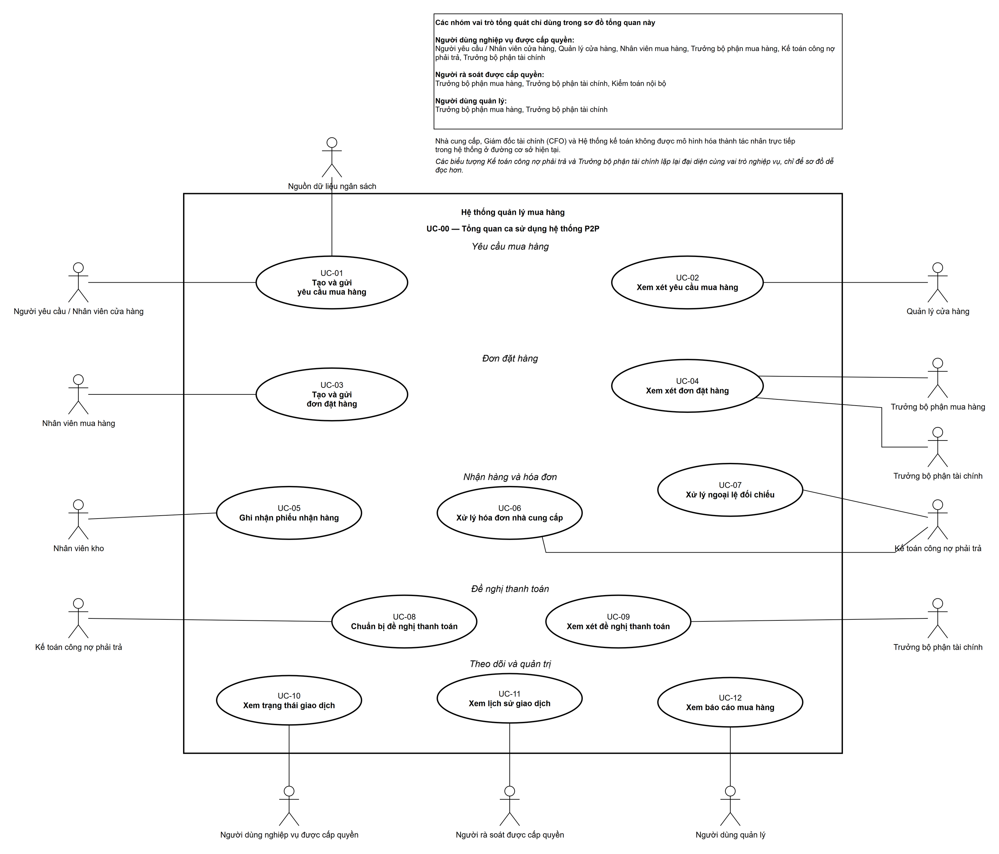
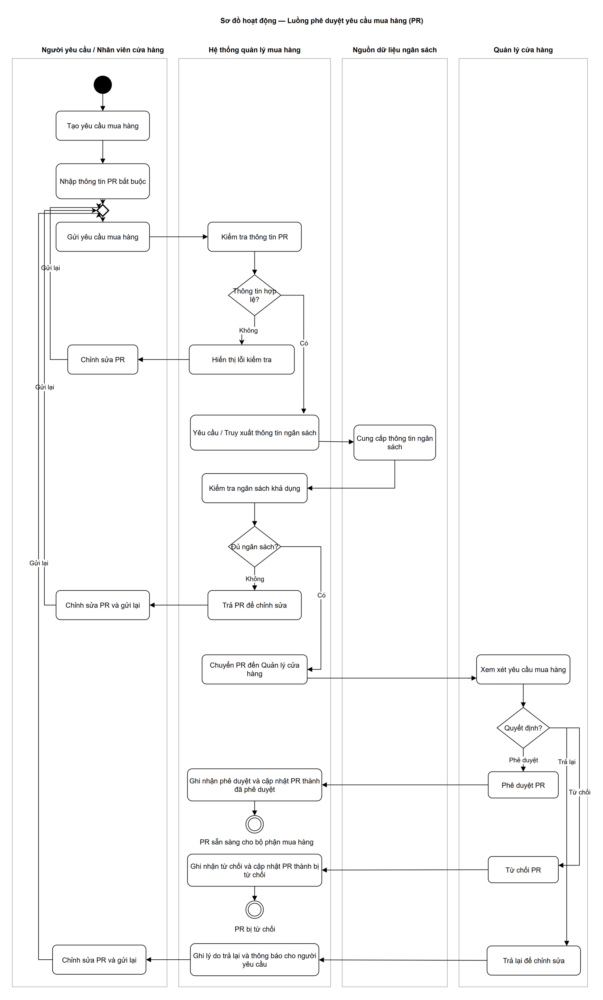
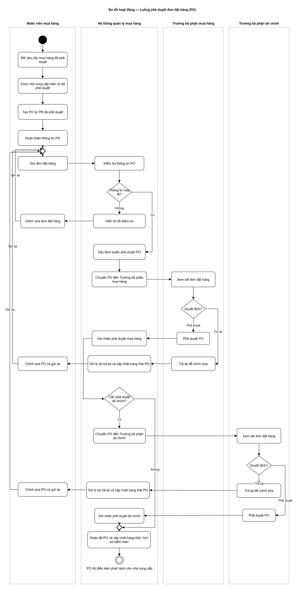
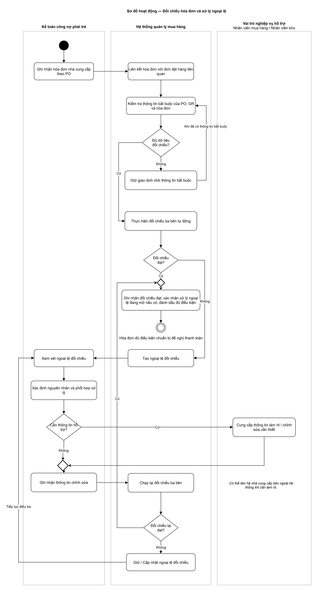

# 06 — Phân tích hệ thống

## 1. Tổng quan

Phần này xác định ai sử dụng **Hệ thống quản lý mua hàng**, mỗi người cần thực hiện việc gì và hệ thống phản hồi ra sao theo quy trình To-Be. Các ca sử dụng (Use Case — UC) mô tả tương tác; sơ đồ hoạt động làm rõ thứ tự xử lý và các nhánh quyết định. Có 12 UC chính, UC-00 tổng quan và ba sơ đồ hoạt động; đây là mô hình phân tích, chưa thiết kế hoặc triển khai phần mềm.

Phạm vi gồm hàng hóa hữu hình, từ lập yêu cầu mua hàng (Purchase Requisition — PR) đến phê duyệt đề nghị thanh toán. Mua dịch vụ và thực hiện thanh toán ngân hàng nằm ngoài phạm vi.

**Đọc theo nhu cầu:** [Danh mục UC và sơ đồ](#42-danh-mục-ca-sử-dụng) · [Đặc tả kịch bản](./use-case-specifications.md) · [Sơ đồ hoạt động](#5-sơ-đồ-hoạt-động) · [Ánh xạ BRQ–UC](#8-truy-vết-từ-yêu-cầu-nghiệp-vụ-đến-ca-sử-dụng).

## 2. Ranh giới hệ thống

### Hệ thống được phân tích

**Hệ thống quản lý mua hàng**

Các mục tiêu người dùng được liệt kê trong [danh mục UC](#42-danh-mục-ca-sử-dụng); [đặc tả UC-00](./use-case-specifications.md#uc-00--tổng-quan-ca-sử-dụng-hệ-thống-p2p) mô tả khả năng hệ thống ở mức tổng quan.

### Điều kiện phụ thuộc bên ngoài / hỗ trợ

**Nguồn dữ liệu ngân sách** là hệ thống hỗ trợ bên ngoài, cung cấp thông tin cho bước kiểm tra ngân sách tự động.

Các thành phần sau được chủ ý không mô hình hóa là tác nhân hệ thống trực tiếp:

- **Nhà cung cấp** — vẫn là bên tham gia nghiệp vụ bên ngoài; cổng thông tin nhà cung cấp nằm ngoài phạm vi.
- **Giám đốc tài chính (CFO)** — Nhà bảo trợ cấp điều hành, không phải người dùng hệ thống vận hành hằng ngày.
- **Hệ thống kế toán** — vẫn là điều kiện phụ thuộc hiện có, nhưng giao diện tích hợp chi tiết chưa được xác định.

---

## 3. Tác nhân hệ thống

| ID | Tác nhân | Vai trò |
|---|---|---|
| ACT-01 | Người yêu cầu / Nhân viên cửa hàng | Lập và gửi yêu cầu mua hàng |
| ACT-02 | Quản lý cửa hàng | Xem xét và quyết định phê duyệt nghiệp vụ cho yêu cầu mua hàng |
| ACT-03 | Nhân viên mua hàng | Xử lý PR đã phê duyệt và lập/quản lý đơn đặt hàng |
| ACT-04 | Trưởng bộ phận mua hàng | Xem xét và phê duyệt hoặc trả về đơn đặt hàng |
| ACT-05 | Nhân viên kho | Ghi phiếu nhận hàng theo đơn đặt hàng đã phê duyệt |
| ACT-06 | Kế toán công nợ phải trả (AP) | Xử lý hóa đơn nhà cung cấp, ngoại lệ đối chiếu và đề nghị thanh toán |
| ACT-07 | Trưởng bộ phận tài chính | Xem xét tài chính PO có điều kiện và phê duyệt đề nghị thanh toán |
| ACT-08 | Kiểm toán nội bộ | Xem lịch sử giao dịch và phê duyệt |
| ACT-09 | Nguồn dữ liệu ngân sách | Cung cấp thông tin ngân sách cần cho kiểm tra ngân sách |

---

## 4. Mô hình ca sử dụng

### 4.1 Tổng quan ca sử dụng hệ thống

Sơ đồ tổng quan trình bày mục tiêu hệ thống chính và tác nhân chính tương ứng, không tái hiện toàn bộ trình tự nghiệp vụ xuyên suốt đã ghi bằng BPMN.

> Quan hệ ca sử dụng mô tả mục tiêu tác nhân và tương tác hệ thống. Trình tự quy trình được mô hình hóa riêng bằng BPMN và sơ đồ hoạt động.

[Danh mục nguồn Draw.io và ảnh xuất theo trang](../assets/diagrams/sources/README.md) giữ ánh xạ nguồn/PNG và lịch sử kiểm tra. [URL trình biên tập bên ngoài](../assets/diagrams/editable-references/) là tham chiếu lịch sử.

### 4.2 Danh mục ca sử dụng

| ID | Ca sử dụng | Tác nhân chính | Sơ đồ |
|---|---|---|---|
| UC-01 | Lập và gửi yêu cầu mua hàng | Người yêu cầu / Nhân viên cửa hàng | [Xem](../assets/diagrams/exports/system/use-case/UC-01.drawio.png) |
| UC-02 | Xem xét yêu cầu mua hàng | Quản lý cửa hàng | [Xem](../assets/diagrams/exports/system/use-case/UC-02.drawio.png) |
| UC-03 | Lập và gửi đơn đặt hàng | Nhân viên mua hàng | [Xem](../assets/diagrams/exports/system/use-case/UC-03.drawio.png) |
| UC-04 | Xem xét đơn đặt hàng | Trưởng bộ phận mua hàng | [Xem](../assets/diagrams/exports/system/use-case/UC-04.drawio.png) |
| UC-05 | Ghi nhận phiếu nhận hàng | Nhân viên kho | [Xem](../assets/diagrams/exports/system/use-case/UC-05.drawio.png) |
| UC-06 | Xử lý hóa đơn nhà cung cấp | Kế toán công nợ phải trả | [Xem](../assets/diagrams/exports/system/use-case/UC-06.drawio.png) |
| UC-07 | Xử lý ngoại lệ đối chiếu | Kế toán công nợ phải trả | [Xem](../assets/diagrams/exports/system/use-case/UC-07.drawio.png) |
| UC-08 | Chuẩn bị đề nghị thanh toán | Kế toán công nợ phải trả | [Xem](../assets/diagrams/exports/system/use-case/UC-08.drawio.png) |
| UC-09 | Xem xét đề nghị thanh toán | Trưởng bộ phận tài chính | [Xem](../assets/diagrams/exports/system/use-case/UC-09.drawio.png) |
| UC-10 | Xem trạng thái giao dịch | Người dùng vận hành được cấp quyền | [Xem](../assets/diagrams/exports/system/use-case/UC-10.drawio.png) |
| UC-11 | Xem lịch sử giao dịch | Người xem xét được cấp quyền / Kiểm toán nội bộ | [Xem](../assets/diagrams/exports/system/use-case/UC-11.drawio.png) |
| UC-12 | Xem báo cáo mua hàng | Trưởng bộ phận mua hàng / Trưởng bộ phận tài chính | [Xem](../assets/diagrams/exports/system/use-case/UC-12.drawio.png) |

### 4.3 Đặc tả ca sử dụng chi tiết

[Đặc tả UC-01–UC-12](./use-case-specifications.md) mô tả mục tiêu, tác nhân, điều kiện trước và sau, luồng chính, nhánh thay thế và ngoại lệ của từng UC. Tài liệu cũng ghi nguồn yêu cầu nghiệp vụ (BRQ), quy tắc nghiệp vụ (BR) và quyết định còn mở (OD). Dùng danh mục phía trên để chọn UC, sau đó mở đặc tả để đọc kịch bản.

---

## 5. Sơ đồ hoạt động

Ba sơ đồ hoạt động dưới đây làm rõ các quyết định, bước chuyển xử lý và vòng lặp ngoại lệ trong luồng phê duyệt PR, phê duyệt PO và đối chiếu hóa đơn.

### 5.1 Luồng phê duyệt PR

**Kiểm soát chính:** Kiểm tra ngân sách phải đạt trước khi PR được chuyển phê duyệt nghiệp vụ.

---

### 5.2 Luồng phê duyệt PO

**Kiểm soát chính:** Phê duyệt tài chính có điều kiện và chỉ bắt buộc khi thỏa mãn tiêu chí phê duyệt áp dụng.

---

### 5.3 Đối chiếu hóa đơn và xử lý ngoại lệ

**Kiểm soát chính:** Hóa đơn không được đi theo đường chuẩn bị thanh toán thông thường cho đến khi thỏa mãn các kiểm soát đối chiếu áp dụng.

---

## 6. Quyết định mô hình hóa chính

Phân tích hệ thống tuân theo đường cơ sở nghiệp vụ được thiết lập ở các giai đoạn trước.

### Yêu cầu mua hàng

- Kiểm tra ngân sách được thực hiện trước phê duyệt của Quản lý cửa hàng.
- Quản lý cửa hàng quyết định phê duyệt nghiệp vụ, không tính toán ngân sách.
- Kiểm tra ngân sách không đạt chặn PR tiếp tục.
- PR bị trả về cần lý do và được phép chỉnh sửa, gửi lại sau khi kiểm tra lại trường bắt buộc và ngân sách. PR bị từ chối không được mở lại hoặc gửi lại như cùng một PR trong đường cơ sở này.

### Đơn đặt hàng

- PO phải bắt nguồn từ PR đã phê duyệt.
- Dữ liệu PR áp dụng được tái sử dụng khi lập PO.
- Lựa chọn nhà cung cấp giới hạn trong danh mục nhà cung cấp hiện có đã được phê duyệt.
- Phê duyệt của Trưởng bộ phận mua hàng bắt buộc với mọi PO; phê duyệt có điều kiện của Trưởng bộ phận tài chính là bổ sung. Mọi phê duyệt bắt buộc phải hoàn tất trước phát hành.
- Không được phát hành PO cho đến khi hoàn tất mọi phê duyệt bắt buộc.

### Phiếu nhận hàng và đối chiếu hóa đơn

- Phiếu nhận hàng phải tham chiếu PO đã phê duyệt.
- Xử lý hóa đơn nhà cung cấp giới hạn ở giao dịch mua theo PO trong phạm vi hiện tại.
- Đối chiếu ba bên đánh giá thông tin PO, GR và hóa đơn.
- Sai lệch tạo ngoại lệ có kiểm soát.
- Sau chỉnh sửa, phải đối chiếu lại đạt mới xác nhận ngoại lệ đã xử lý và đủ điều kiện chuẩn bị hoặc gửi đề nghị thanh toán. Chỉ ghi nhận chỉnh sửa chưa đủ để chuyển tiếp.

### Đề nghị thanh toán

- Kế toán công nợ phải trả chuẩn bị đề nghị thanh toán.
- Trưởng bộ phận tài chính thực hiện phê duyệt đề nghị thanh toán cuối cùng.
- **Đề nghị thanh toán đã được phê duyệt** là điểm kết thúc phạm vi P2P được mô hình hóa; không có nghĩa đã thanh toán hoặc Nhà cung cấp đã nhận tiền.
- Thực hiện thanh toán ngân hàng và đối soát nằm ngoài phạm vi.

### Khả năng theo dõi và quản trị

- Người dùng được cấp quyền có thể xem trạng thái giao dịch liên quan.
- Hành động chính và quyết định phê duyệt được giữ trong lịch sử giao dịch.
- Kiểm toán nội bộ có vai trò xem xét, không phải phê duyệt vận hành.
- Quyền chi tiết theo vai trò sẽ được làm rõ sau.

---

## 7. Quyết định nghiệp vụ còn mở

Các quyết định dưới đây vẫn còn mở, chưa phải quy tắc hệ thống đã được xác nhận:

| ID | Quyết định còn mở |
|---|---|
| OD-01 | Ngưỡng tiền phê duyệt đơn đặt hàng chính xác |
| OD-02 | Tiêu chí cần phê duyệt tài chính bổ sung |
| OD-03 | Chính sách kiểm tra ngân sách chi tiết |
| OD-04 | Chính sách và giá trị dung sai đối chiếu ba bên, nếu áp dụng |
| OD-05 | Quy tắc chuyển cấp ngoại lệ đối chiếu |
| OD-06 | Mô hình trạng thái giao dịch mua hàng cuối cùng |
| OD-07 | Quyền chi tiết theo vai trò |
| OD-08 | Chính sách nhận hàng một phần |

Các quyết định này sẽ được làm rõ trong phân tích yêu cầu chi tiết và xác nhận với các bên liên quan.

---

## 8. Truy vết từ yêu cầu nghiệp vụ đến ca sử dụng

| Yêu cầu nghiệp vụ | Ca sử dụng liên quan |
|---|---|
| BRQ-01 — Quản lý giao dịch P2P liên thông | UC-01, UC-03, UC-05, UC-06, UC-08; UC-09 hỗ trợ điểm kết thúc phê duyệt |
| BRQ-02 — Quản lý yêu cầu mua hàng chuẩn hóa | UC-01, UC-02 |
| BRQ-03 — Kiểm soát ngân sách bắt buộc | UC-01, UC-02 |
| BRQ-04 — Lựa chọn nhà cung cấp có kiểm soát | UC-03 |
| BRQ-05 — Quản lý và phê duyệt đơn đặt hàng chuẩn hóa | UC-03, UC-04 |
| BRQ-06 — Tái sử dụng dữ liệu mua hàng và liên kết giao dịch | UC-03, UC-05, UC-06, UC-10 |
| BRQ-07 — Khả năng theo dõi trạng thái mua hàng | UC-10; UC-12 hỗ trợ tổng hợp trạng thái |
| BRQ-08 — Đối chiếu ba bên và xử lý ngoại lệ có kiểm soát | UC-05, UC-06, UC-07 |
| BRQ-09 — Truy vết giao dịch và phê duyệt | UC-01–UC-09 là hành vi xuyên suốt, UC-11 là chức năng xem xét riêng |
| BRQ-10 — Phê duyệt đề nghị thanh toán có kiểm soát | UC-08, UC-09 |
| BRQ-11 — Báo cáo mua hàng cơ bản | UC-12 |

Ánh xạ này cho biết UC nào xử lý từng yêu cầu nghiệp vụ; SRS cụ thể hóa các UC thành yêu cầu phần mềm.

---

## 9. Sản phẩm đầu ra

- [Đặc tả ca sử dụng](./use-case-specifications.md): nguồn chính cho kịch bản chi tiết.
- [Danh mục 18 nguồn Draw.io và PNG](../assets/diagrams/sources/README.md): gồm BPMN, UC và ba sơ đồ hoạt động; nguồn chỉnh sửa chính thức nằm trong kho.

## 10. Chuyển tiếp sang SRS

[Đặc tả yêu cầu phần mềm (SRS)](../07-software-requirements/srs.md) cụ thể hóa UC thành yêu cầu chức năng (FR), phi chức năng (NFR) và tiêu chí chấp nhận (AC). [Ma trận truy vết yêu cầu (RTM)](../08-traceability/requirements-traceability-matrix.md) ghi các liên kết và phần còn thiếu. Các mô hình và tiêu chí này chưa phải kết quả kiểm thử phần mềm hoặc nghiệm thu.

Trước: [05 — Yêu cầu nghiệp vụ](../05-brd/README.md). Tiếp theo: [07 — Yêu cầu phần mềm](../07-software-requirements/README.md).
