# Đặc tả ca sử dụng

## 1. Mục đích

Tài liệu hợp nhất mô hình ca sử dụng (Use Case — UC) và đặc tả ca sử dụng chi tiết cho **Hệ thống quản lý mua hàng NovaRetail**.

Phạm vi hệ thống bao phủ mua hàng hóa hữu hình từ **lập yêu cầu mua hàng** đến **phê duyệt đề nghị thanh toán**. Mua dịch vụ, nghiệm thu/đối chiếu dịch vụ, thực hiện thanh toán ngân hàng thực tế, tiếp nhận nhà cung cấp mới, RFQ/RFP, quản lý hợp đồng và thay thế toàn bộ ERP/kế toán nằm ngoài phạm vi nghiên cứu tình huống này.

Tài liệu được tổ chức như sau:

- UC-00: Tổng quan ca sử dụng hệ thống
- UC-01 đến UC-12: Các ca sử dụng nghiệp vụ chi tiết
- Mỗi ca sử dụng có sơ đồ tương ứng xuất từ Draw.io

> **Lưu ý mô hình hóa:** Sơ đồ ca sử dụng mô tả mục tiêu tác nhân và tương tác với hệ thống. Trình tự quy trình xuyên suốt được mô hình hóa riêng bằng BPMN.

[Các trang Draw.io chỉnh sửa được tại kho](../assets/diagrams/sources/README.md) là nguồn chuẩn để chỉnh sửa. Mọi trang đã được kết xuất và kiểm tra trực quan bằng Draw.io Desktop 32.4.1; các PNG đã chỉnh bên dưới chứa siêu dữ liệu khớp nguồn. UC-01 bao gồm kiểm tra bắt buộc trường dữ liệu và ngân sách trong lần gửi thành công. UC-04 mở rộng Xem xét PO tại điểm mở rộng xem xét tài chính bổ sung được đặt tên khi tiêu chí được cấu hình yêu cầu phê duyệt tài chính. UC-06 cho phép ghi nhận hóa đơn trong khi chờ dữ liệu đối chiếu. UC-07 bao gồm đối chiếu lại bắt buộc để xác nhận đã xử lý; đối chiếu lại không đạt giữ ngoại lệ hiện có ở trạng thái mở.

---

## UC-00 — Tổng quan ca sử dụng hệ thống P2P

### 2.1 Ranh giới hệ thống

**Hệ thống được phân tích:** Hệ thống quản lý mua hàng

Hệ thống hỗ trợ lập và phê duyệt yêu cầu mua hàng (Purchase Requisition — PR), điều phối kiểm tra ngân sách, lập và phê duyệt đơn đặt hàng (Purchase Order — PO), ghi phiếu nhận hàng (Goods Receipt — GR), xử lý hóa đơn nhà cung cấp, đối chiếu ba bên tự động, xử lý ngoại lệ đối chiếu, chuẩn bị và phê duyệt đề nghị thanh toán (Payment Request), theo dõi trạng thái giao dịch, lịch sử giao dịch và khả năng kiểm toán, cùng báo cáo mua hàng cơ bản.

### 2.2 Tác nhân cốt lõi

| Tác nhân | Vai trò trong hệ thống |
|---|---|
| Người yêu cầu / Nhân viên cửa hàng | Lập và gửi yêu cầu mua hàng |
| Quản lý cửa hàng | Xem xét và quyết định phê duyệt nghiệp vụ cho yêu cầu mua hàng |
| Nhân viên mua hàng | Xử lý PR đã phê duyệt và lập đơn đặt hàng |
| Trưởng bộ phận mua hàng | Xem xét và phê duyệt hoặc trả về đơn đặt hàng |
| Nhân viên kho | Ghi phiếu nhận hàng theo đơn đặt hàng đã phê duyệt |
| Kế toán công nợ phải trả (AP) | Xử lý hóa đơn nhà cung cấp, ngoại lệ đối chiếu và đề nghị thanh toán |
| Trưởng bộ phận tài chính | Xem xét tài chính PO có điều kiện và phê duyệt đề nghị thanh toán |
| Kiểm toán nội bộ | Xem xét lịch sử giao dịch và phê duyệt |
| Nguồn dữ liệu ngân sách | Cung cấp thông tin ngân sách cần cho kiểm tra ngân sách tự động |

### 2.3 Tác nhân không được mô hình hóa là người dùng hệ thống trực tiếp

- **Nhà cung cấp:** Bên tham gia nghiệp vụ bên ngoài, nhưng cổng thông tin nhà cung cấp nằm ngoài phạm vi.
- **Giám đốc tài chính (CFO):** Nhà bảo trợ cấp điều hành, không phải tác nhân dùng hệ thống hằng ngày.
- **Hệ thống kế toán:** Điều kiện phụ thuộc hiện có, nhưng giao diện tích hợp chi tiết chưa được xác định.

### 2.4 Danh mục ca sử dụng

| ID | Ca sử dụng | Tác nhân chính |
|---|---|---|
| UC-01 | Lập và gửi yêu cầu mua hàng | Người yêu cầu / Nhân viên cửa hàng |
| UC-02 | Xem xét yêu cầu mua hàng | Quản lý cửa hàng |
| UC-03 | Lập và gửi đơn đặt hàng | Nhân viên mua hàng |
| UC-04 | Xem xét đơn đặt hàng | Trưởng bộ phận mua hàng |
| UC-05 | Ghi nhận phiếu nhận hàng | Nhân viên kho |
| UC-06 | Xử lý hóa đơn nhà cung cấp | Kế toán công nợ phải trả |
| UC-07 | Xử lý ngoại lệ đối chiếu | Kế toán công nợ phải trả |
| UC-08 | Chuẩn bị đề nghị thanh toán | Kế toán công nợ phải trả |
| UC-09 | Xem xét đề nghị thanh toán | Trưởng bộ phận tài chính |
| UC-10 | Xem trạng thái giao dịch | Người dùng vận hành được cấp quyền |
| UC-11 | Xem lịch sử giao dịch | Người xem xét được cấp quyền / Kiểm toán nội bộ |
| UC-12 | Xem báo cáo mua hàng | Trưởng bộ phận mua hàng / Trưởng bộ phận tài chính |

---

# 3. Đặc tả ca sử dụng chi tiết

## UC-01 — Lập và gửi yêu cầu mua hàng

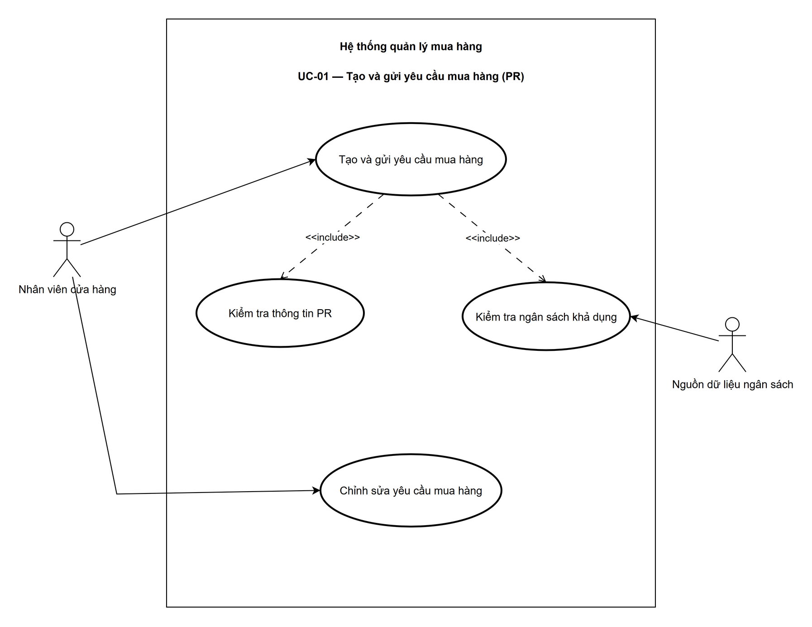

### Tóm tắt ca sử dụng

| Nội dung | Mô tả |
|---|---|
| **Mã ca sử dụng** | UC-01 |
| **Tên ca sử dụng** | Lập và gửi yêu cầu mua hàng |
| **Tác nhân chính** | Người yêu cầu / Nhân viên cửa hàng |
| **Tác nhân hỗ trợ** | Nguồn dữ liệu ngân sách |
| **Mục tiêu** | Lập yêu cầu mua hàng, cung cấp thông tin mua hàng bắt buộc và gửi phê duyệt nghiệp vụ sau khi kiểm tra và kiểm soát ngân sách đạt. |
| **Sự kiện kích hoạt** | Người yêu cầu xác định nhu cầu mua hàng. |
| **BRQ liên quan** | BRQ-01, BRQ-02, BRQ-03, BRQ-09 |
| **Quy tắc nghiệp vụ liên quan** | BR-01, BR-02, BR-03, BR-25, BR-26 |

### Điều kiện tiên quyết

1. Người yêu cầu là người dùng hệ thống được cấp quyền.
2. Người yêu cầu gắn với cửa hàng, bộ phận và/hoặc trung tâm chi phí hợp lệ tùy trường hợp.
3. Thông tin ngân sách có sẵn cho quy trình mua hàng.

### Luồng chính

1. Người yêu cầu bắt đầu yêu cầu mua hàng mới cho hàng hóa hữu hình trong đường cơ sở này.
2. Người yêu cầu nhập thông tin mua hàng bắt buộc.
3. Người yêu cầu gửi yêu cầu mua hàng.
4. Hệ thống kiểm tra thông tin PR bắt buộc.
5. Hệ thống yêu cầu hoặc lấy thông tin ngân sách áp dụng.
6. Hệ thống kiểm tra ngân sách khả dụng.
7. Kiểm tra ngân sách đạt.
8. Hệ thống ghi hành động gửi và cập nhật trạng thái PR.
9. PR được chuyển đến Quản lý cửa hàng phê duyệt nghiệp vụ.

### Luồng thay thế A1 — Thông tin PR thiếu hoặc không hợp lệ

1. Người yêu cầu gửi PR.
2. Hệ thống phát hiện thông tin bắt buộc thiếu hoặc không hợp lệ.
3. Hệ thống hiển thị các vấn đề kiểm tra.
4. PR không được chuyển phê duyệt.
5. Người yêu cầu chỉnh sửa thông tin và gửi lại PR.

### Luồng thay thế A2 — Không đủ ngân sách

1. Hệ thống thực hiện kiểm tra ngân sách.
2. Ngân sách khả dụng không đủ.
3. PR bị chặn chuyển phê duyệt nghiệp vụ.
4. Hệ thống trả PR để chỉnh sửa.
5. Người yêu cầu chỉnh sửa PR và gửi lại.
6. Kiểm tra trường bắt buộc và ngân sách áp dụng được thực hiện lại trước bước Quản lý cửa hàng xem xét.

### Luồng thay thế A3 — PR bị trả về sau xem xét nghiệp vụ

1. Quản lý cửa hàng trả PR để chỉnh sửa qua UC-02.
2. Người yêu cầu mở PR bị trả về.
3. Người yêu cầu chỉnh sửa thông tin bắt buộc.
4. Người yêu cầu gửi lại PR.
5. Hệ thống lặp lại kiểm tra trường bắt buộc và ngân sách áp dụng trước bước Quản lý cửa hàng xem xét.

### Điều kiện sau

**Thành công**
- PR được gửi thành công.
- Thông tin bắt buộc hợp lệ.
- Kiểm tra ngân sách đã đạt.
- PR sẵn sàng để Quản lý cửa hàng xem xét.
- Hành động gửi được giữ trong lịch sử giao dịch.

**Không thành công / chưa hoàn tất**
- PR vẫn chưa được chuyển phê duyệt nghiệp vụ cho đến khi các vấn đề kiểm tra được khắc phục.

### Ghi chú

- Kiểm tra ngân sách là kiểm soát hệ thống; Quản lý cửa hàng không thực hiện tính toán ngân sách thủ công.
- Không giả định Trưởng bộ phận tài chính được ghi đè khi thiếu ngân sách.
- Định nghĩa trường chi tiết được để lại cho SRS.

---

## UC-02 — Xem xét yêu cầu mua hàng

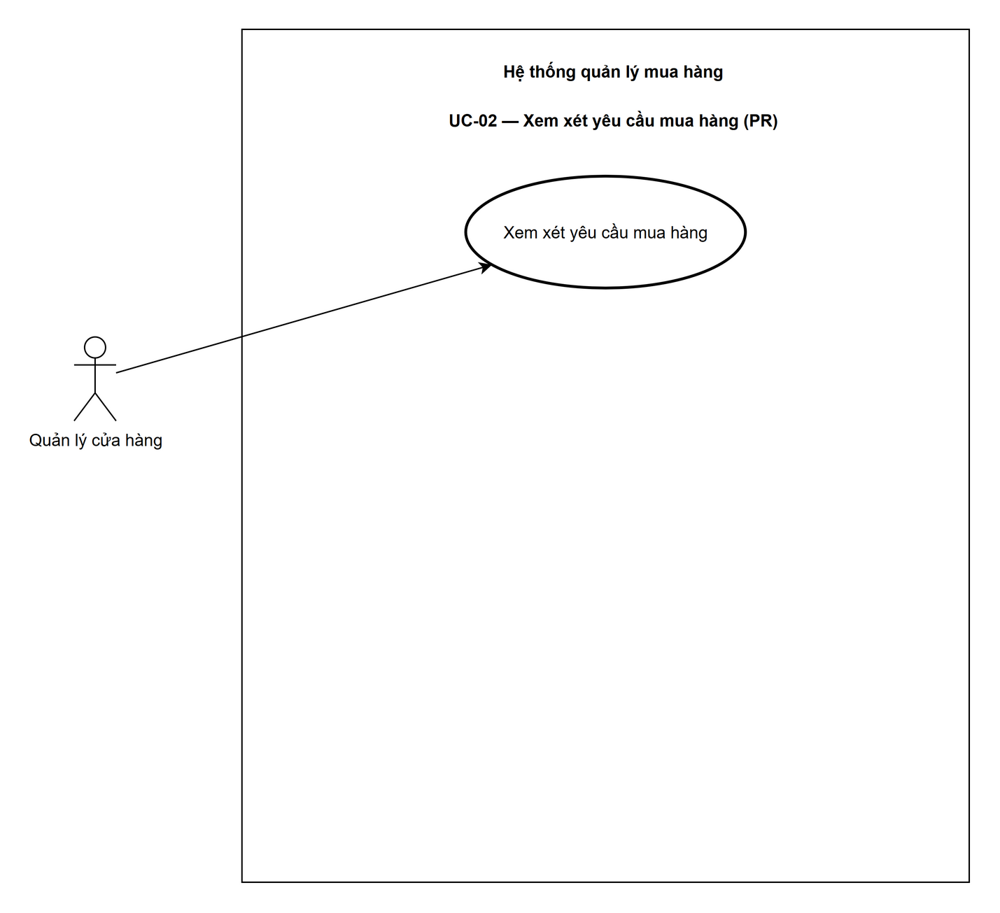

### Tóm tắt ca sử dụng

| Nội dung | Mô tả |
|---|---|
| **Mã ca sử dụng** | UC-02 |
| **Tên ca sử dụng** | Xem xét yêu cầu mua hàng |
| **Tác nhân chính** | Quản lý cửa hàng |
| **Mục tiêu** | Xem xét yêu cầu mua hàng đã kiểm tra đạt và đưa ra quyết định phê duyệt nghiệp vụ cần thiết. |
| **Sự kiện kích hoạt** | PR đã gửi và đạt kiểm tra ngân sách được chuyển đến Quản lý cửa hàng. |
| **BRQ liên quan** | BRQ-02, BRQ-03, BRQ-09 |
| **Quy tắc nghiệp vụ liên quan** | BR-02, BR-04, BR-05, BR-25, BR-26 |

### Điều kiện tiên quyết

1. PR đã được gửi.
2. Thông tin PR bắt buộc đã đạt kiểm tra.
3. Kiểm tra ngân sách áp dụng đã đạt.
4. PR đang chờ phê duyệt nghiệp vụ.
5. Quản lý cửa hàng có quyền xem xét PR.

### Luồng chính — Phê duyệt PR

1. Quản lý cửa hàng mở PR đang chờ.
2. Hệ thống hiển thị thông tin PR liên quan đến quyết định phê duyệt.
3. Quản lý cửa hàng xem xét nhu cầu mua hàng.
4. Quản lý cửa hàng chọn **Phê duyệt**.
5. Hệ thống ghi quyết định phê duyệt, người phê duyệt và dấu thời gian.
6. Trạng thái PR được cập nhật sang trạng thái đã phê duyệt áp dụng.
7. PR đã phê duyệt trở nên có sẵn để bộ phận mua hàng xử lý.

### Luồng thay thế A1 — Từ chối PR

1. Quản lý cửa hàng xem xét PR.
2. Quản lý cửa hàng chọn **Từ chối**.
3. Hệ thống ghi quyết định từ chối.
4. PR được cập nhật sang trạng thái bị từ chối áp dụng.
5. PR không chuyển sang xử lý mua hàng.

### Luồng thay thế A2 — Trả PR để chỉnh sửa

1. Quản lý cửa hàng xem xét PR.
2. Quản lý cửa hàng chọn **Trả lại để chỉnh sửa**.
3. Hệ thống yêu cầu và ghi lý do cùng quyết định trả về.
4. PR được trả về Người yêu cầu.
5. Người yêu cầu chỉnh sửa và gửi lại PR qua UC-01, trong đó lặp lại kiểm tra trường bắt buộc và ngân sách áp dụng trước khi chuyển phê duyệt.

### Điều kiện sau

**Đã phê duyệt** — PR đã phê duyệt và có sẵn để bộ phận mua hàng xử lý.

**Đã từ chối** — PR không chuyển sang bộ phận mua hàng và không được mở lại hoặc gửi lại như cùng một PR trong đường cơ sở này.

**Đã trả về** — PR được trả về Người yêu cầu để chỉnh sửa.

### Ghi chú

- Kiểm tra ngân sách hoàn tất trước ca sử dụng này.
- Quản lý cửa hàng quyết định phê duyệt nghiệp vụ, không thực hiện kiểm soát ngân sách tự động.
- PR bị từ chối không dùng đường trả về và gửi lại. Mở lại PR bị từ chối cần chính sách nghiệp vụ riêng, chưa được xác định trong nghiên cứu tình huống này.

---

## UC-03 — Lập và gửi đơn đặt hàng

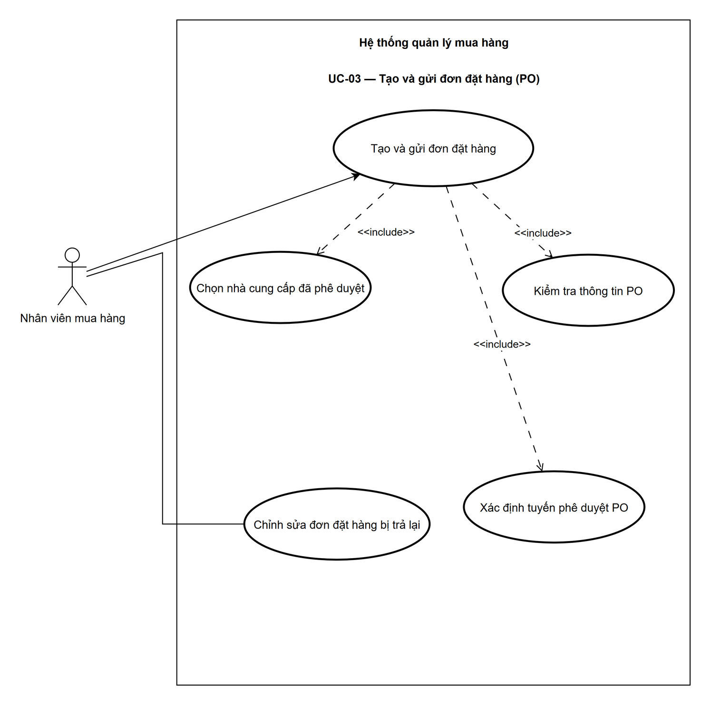

### Tóm tắt ca sử dụng

| Nội dung | Mô tả |
|---|---|
| **Mã ca sử dụng** | UC-03 |
| **Tên ca sử dụng** | Lập và gửi đơn đặt hàng |
| **Tác nhân chính** | Nhân viên mua hàng |
| **Mục tiêu** | Lập đơn đặt hàng từ PR đã phê duyệt, chọn nhà cung cấp hiện có đã phê duyệt, hoàn thiện thông tin PO và gửi PO phê duyệt. |
| **Sự kiện kích hoạt** | PR đã phê duyệt sẵn sàng để bộ phận mua hàng xử lý. |
| **BRQ liên quan** | BRQ-01, BRQ-04, BRQ-05, BRQ-06, BRQ-09 |
| **Quy tắc nghiệp vụ liên quan** | BR-05, BR-06, BR-07, BR-08, BR-09, BR-12, BR-25, BR-26 |

### Điều kiện tiên quyết

1. PR nguồn đã được phê duyệt.
2. Nhân viên mua hàng có quyền xử lý PR.
3. Thông tin danh mục nhà cung cấp đã phê duyệt có sẵn.
4. PR chứa thông tin cần để bắt đầu lập PO.

### Luồng chính

1. Nhân viên mua hàng mở PR đã phê duyệt.
2. Hệ thống hiển thị PR và thông tin mua hàng liên quan.
3. Nhân viên mua hàng chọn nhà cung cấp hiện có đã phê duyệt.
4. Hệ thống tạo hoặc khởi tạo PO từ PR đã phê duyệt.
5. Thông tin PR áp dụng được tái sử dụng trong PO.
6. Nhân viên mua hàng hoàn thiện thông tin riêng của PO như nhà cung cấp, giá, thông tin thương mại và giao hàng tùy trường hợp.
7. Nhân viên mua hàng gửi PO.
8. Hệ thống kiểm tra thông tin PO bắt buộc.
9. Hệ thống đánh giá quy tắc phê duyệt áp dụng.
10. Hệ thống xác định tuyến phê duyệt bắt buộc.
11. PO được chuyển đến người phê duyệt phù hợp.

### Luồng thay thế A1 — Thông tin PO không hợp lệ

1. Nhân viên mua hàng gửi PO.
2. Hệ thống phát hiện thông tin bắt buộc thiếu hoặc không hợp lệ.
3. Hệ thống hiển thị các vấn đề kiểm tra.
4. PO vẫn chưa được chuyển phê duyệt.
5. Nhân viên mua hàng chỉnh sửa PO và gửi lại.

### Luồng thay thế A2 — PO bị trả về để thay đổi

1. Người phê duyệt trả PO qua UC-04.
2. Nhân viên mua hàng mở PO bị trả về.
3. Nhân viên mua hàng xem lý do trả về.
4. Nhân viên mua hàng chỉnh sửa thông tin bắt buộc.
5. Nhân viên mua hàng gửi lại PO.
6. Tuyến phê duyệt được đánh giá lại tùy trường hợp áp dụng.

### Điều kiện sau

- PO đã được lập từ PR đã phê duyệt.
- Tham chiếu PR nguồn được giữ.
- Thông tin PR áp dụng đã được tái sử dụng.
- Đã chọn nhà cung cấp trong danh mục nhà cung cấp đã được phê duyệt.
- PO được gửi vào luồng phê duyệt.

### Ghi chú

- Tiếp nhận nhà cung cấp mới, đánh giá điều kiện nhà cung cấp, RFQ/RFP và đấu thầu nằm ngoài phạm vi.
- Ngưỡng phê duyệt chính xác chưa được xác định trong ca sử dụng này.

---

## UC-04 — Xem xét đơn đặt hàng

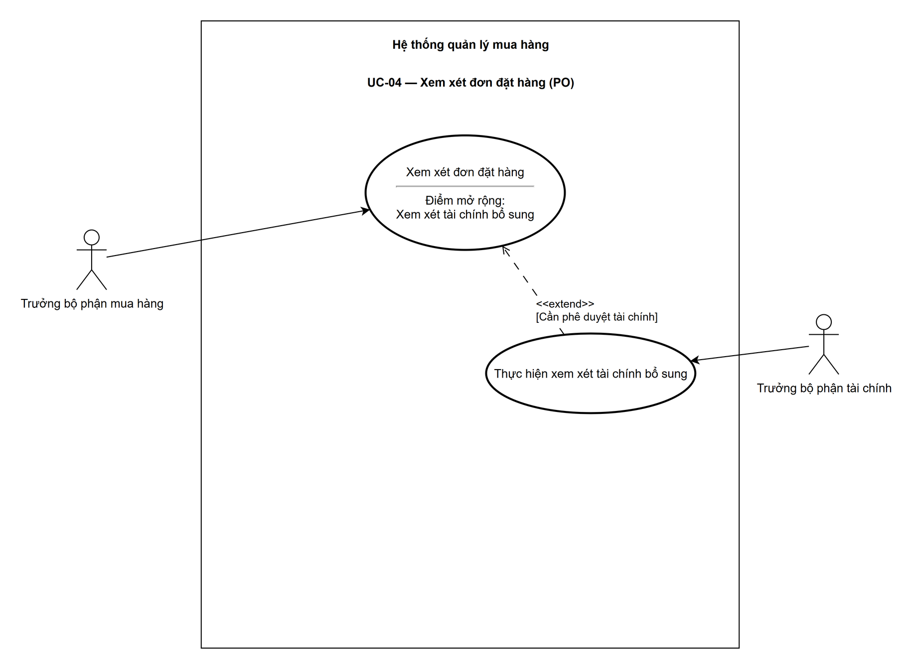

### Tóm tắt ca sử dụng

| Nội dung | Mô tả |
|---|---|
| **Mã ca sử dụng** | UC-04 |
| **Tên ca sử dụng** | Xem xét đơn đặt hàng |
| **Tác nhân chính** | Trưởng bộ phận mua hàng |
| **Tác nhân có điều kiện** | Trưởng bộ phận tài chính |
| **Mục tiêu** | Hoàn tất quy trình phê duyệt PO bắt buộc trước khi PO được phép phát hành. |
| **Sự kiện kích hoạt** | PO đã gửi được chuyển phê duyệt. |
| **BRQ liên quan** | BRQ-05, BRQ-09 |
| **Quy tắc nghiệp vụ liên quan** | BR-09, BR-10, BR-11, BR-12, BR-25, BR-26 |

### Điều kiện tiên quyết

1. PO đã được gửi.
2. Thông tin PO bắt buộc đã đạt kiểm tra.
3. Tuyến phê duyệt áp dụng đã được xác định.
4. Người phê duyệt có quyền cho bước phê duyệt áp dụng.

### Luồng chính — Phê duyệt mua hàng

1. Trưởng bộ phận mua hàng mở PO đang chờ.
2. Hệ thống hiển thị PO và thông tin giao dịch nguồn liên quan.
3. Trưởng bộ phận mua hàng xem xét PO.
4. Trưởng bộ phận mua hàng phê duyệt PO.
5. Hệ thống ghi quyết định phê duyệt.
6. Hệ thống xác định có cần phê duyệt tài chính bổ sung hay không.

### Phần tiếp nối luồng chính A — Không cần phê duyệt tài chính bổ sung

7. Không cần phê duyệt tài chính bổ sung.
8. Mọi phê duyệt bắt buộc đã hoàn tất.
9. Hệ thống cập nhật PO sang trạng thái đã phê duyệt/hoàn tất áp dụng.
10. PO đã phê duyệt trở thành đủ điều kiện phát hành cho Nhà cung cấp.

### Phần tiếp nối luồng chính B — Cần phê duyệt tài chính bổ sung

7. Hệ thống chuyển PO đến Trưởng bộ phận tài chính.
8. Trưởng bộ phận tài chính xem xét PO từ góc độ kiểm soát tài chính.
9. Trưởng bộ phận tài chính phê duyệt PO.
10. Hệ thống ghi phê duyệt tài chính.
11. Mọi phê duyệt bắt buộc đã hoàn tất.
12. PO trở thành đủ điều kiện phát hành cho Nhà cung cấp.

### Luồng thay thế A1 — Trưởng bộ phận mua hàng trả PO

1. Trưởng bộ phận mua hàng xem xét PO.
2. Trưởng bộ phận mua hàng chọn **Trả về để thay đổi**.
3. Hệ thống ghi quyết định và lý do/nhận xét liên quan.
4. PO trở về Nhân viên mua hàng.
5. Nhân viên mua hàng chỉnh sửa và gửi lại PO qua UC-03.

### Luồng thay thế A2 — Trưởng bộ phận tài chính trả PO

1. Cần phê duyệt tài chính bổ sung.
2. Trưởng bộ phận tài chính xem xét PO.
3. Trưởng bộ phận tài chính chọn **Trả về để thay đổi**.
4. Hệ thống ghi quyết định trả về.
5. PO trở về Nhân viên mua hàng để chỉnh sửa.
6. PO phải được gửi lại qua luồng phê duyệt áp dụng.

### Điều kiện sau

**Đã phê duyệt** — Mọi phê duyệt PO bắt buộc đã hoàn tất, lịch sử phê duyệt được giữ và PO sẵn sàng để phát hành ra bên ngoài.

**Đã trả về** — PO được trả về bộ phận mua hàng để chỉnh sửa.

### Quyết định còn mở

- **OD-01:** Ngưỡng tiền phê duyệt PO chính xác.
- **OD-02:** Tiêu chí cần phê duyệt tài chính bổ sung.

### Ghi chú

- Trưởng bộ phận tài chính tham gia có điều kiện, không bắt buộc với mọi PO.
- Không được phát hành PO cho đến khi hoàn tất mọi phê duyệt bắt buộc.

---

## UC-05 — Ghi nhận phiếu nhận hàng

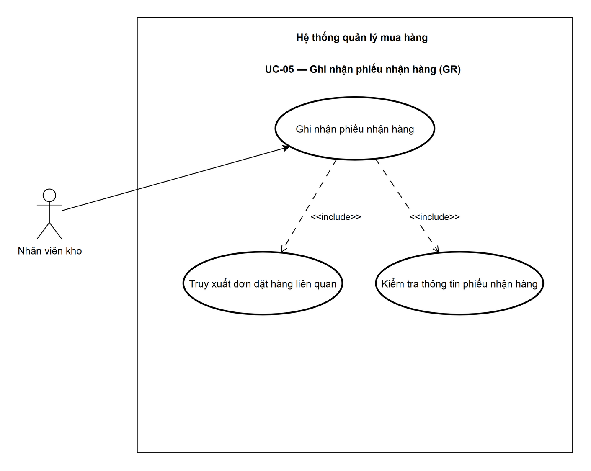

### Tóm tắt ca sử dụng

| Nội dung | Mô tả |
|---|---|
| **Mã ca sử dụng** | UC-05 |
| **Tên ca sử dụng** | Ghi nhận phiếu nhận hàng |
| **Tác nhân chính** | Nhân viên kho |
| **Mục tiêu** | Ghi nhận việc thực nhận hàng theo đúng PO đã phê duyệt. |
| **Sự kiện kích hoạt** | Hàng được giao cho đơn đặt hàng đã phê duyệt. |
| **BRQ liên quan** | BRQ-01, BRQ-06, BRQ-08, BRQ-09 |
| **Quy tắc nghiệp vụ liên quan** | BR-13, BR-14, BR-25, BR-26 |

### Điều kiện tiên quyết

1. Có PO đã phê duyệt hợp lệ.
2. Đã nhận hàng.
3. Nhân viên kho có quyền ghi phiếu nhận hàng.

### Luồng chính

1. Nhân viên kho xác định hoặc tìm PO đã phê duyệt liên quan.
2. Hệ thống hiển thị thông tin PO liên quan.
3. Nhân viên kho kiểm tra số lượng giao và tình trạng hàng.
4. Nhân viên kho nhập thông tin phiếu nhận hàng.
5. Hệ thống kiểm tra thông tin phiếu nhận hàng.
6. Nhân viên kho gửi phiếu nhận hàng.
7. Hệ thống ghi GR theo PO.
8. Hệ thống cập nhật thông tin giao dịch mua hàng liên quan.
9. GR có sẵn cho đối chiếu hóa đơn ở bước sau.

### Luồng thay thế A1 — Thông tin phiếu nhận hàng không hợp lệ

1. Nhân viên kho gửi GR.
2. Hệ thống phát hiện thông tin thiếu hoặc không hợp lệ.
3. Hệ thống hiển thị các vấn đề kiểm tra.
4. GR chưa được hoàn tất.
5. Nhân viên kho chỉnh sửa và gửi lại thông tin.

### Điều kiện sau

- Phiếu nhận hàng được ghi theo đúng PO.
- GR có sẵn cho đối chiếu ba bên.
- Lịch sử giao dịch được cập nhật.

### Quyết định còn mở

- **OD-08:** Chính sách nhận hàng một phần.

### Ghi chú

- Chức năng hệ thống quản lý kho chi tiết nằm ngoài phạm vi.
- Nhận hàng một phần chưa được giả định là quy tắc đã xác nhận cho đến khi OD-08 được giải quyết.

---

## UC-06 — Xử lý hóa đơn nhà cung cấp

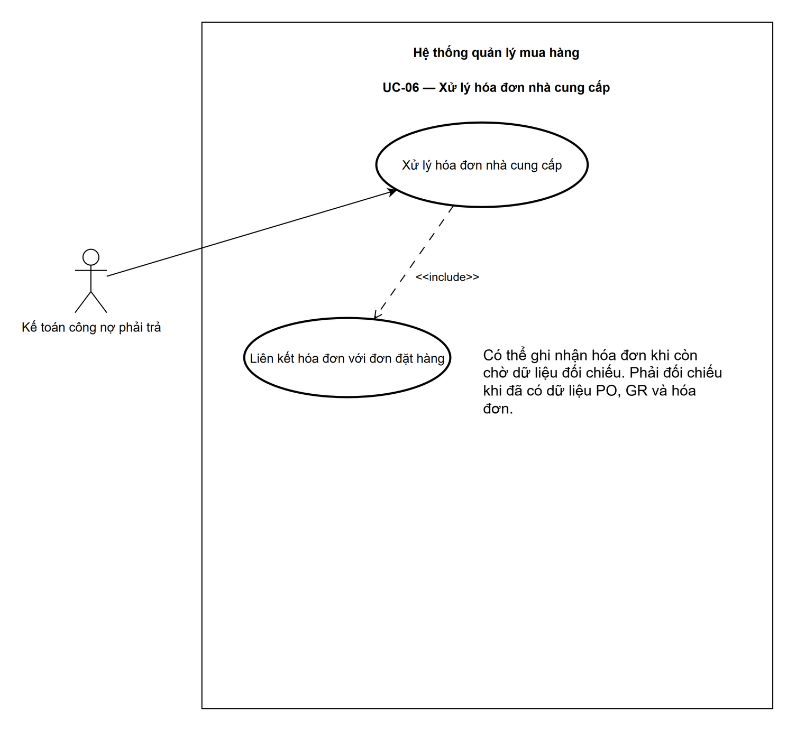

### Tóm tắt ca sử dụng

| Nội dung | Mô tả |
|---|---|
| **Mã ca sử dụng** | UC-06 |
| **Tên ca sử dụng** | Xử lý hóa đơn nhà cung cấp |
| **Tác nhân chính** | Kế toán công nợ phải trả |
| **Mục tiêu** | Ghi hóa đơn nhà cung cấp, liên kết với giao dịch mua hàng liên quan và xử lý qua đối chiếu ba bên. |
| **Sự kiện kích hoạt** | AP nhận hóa đơn nhà cung cấp liên quan giao dịch mua theo PO. |
| **BRQ liên quan** | BRQ-01, BRQ-06, BRQ-08, BRQ-09 |
| **Quy tắc nghiệp vụ liên quan** | BR-15, BR-16, BR-17, BR-18, BR-19, BR-20, BR-25, BR-26 |

### Điều kiện tiên quyết

1. Giao dịch mua nằm trong phạm vi mua hàng theo PO.
2. PO liên quan tồn tại.
3. Kế toán công nợ phải trả có quyền xử lý hóa đơn.

### Luồng chính — Đối chiếu đạt

1. Kế toán công nợ phải trả mở chức năng xử lý hóa đơn nhà cung cấp.
2. Kế toán công nợ phải trả ghi thông tin hóa đơn nhà cung cấp.
3. Hóa đơn được liên kết với PO liên quan.
4. Hệ thống kiểm tra thông tin PO, GR và hóa đơn bắt buộc đã có đủ chưa.
5. Khi có đủ thông tin bắt buộc, hệ thống thực hiện đối chiếu ba bên.
6. Hệ thống so sánh các thuộc tính đối chiếu được xác định trước.
7. Các chứng từ thỏa mãn quy tắc đối chiếu áp dụng.
8. Hệ thống đánh dấu hóa đơn/giao dịch là đối chiếu đạt.
9. Hóa đơn trở thành đủ điều kiện chuẩn bị đề nghị thanh toán.

### Luồng thay thế A1 — Chưa có thông tin đối chiếu bắt buộc

1. Hóa đơn được ghi nhận.
2. Thông tin PO, GR hoặc hóa đơn bắt buộc chưa có đủ.
3. Chưa thể hoàn tất đối chiếu tự động.
4. Giao dịch tiếp tục chờ thông tin bắt buộc và chưa đủ điều kiện chuẩn bị hoặc gửi đề nghị thanh toán.
5. Đối chiếu được thực hiện khi có đủ thông tin bắt buộc.

### Luồng thay thế A2 — Đối chiếu không đạt

1. Hệ thống thực hiện đối chiếu ba bên.
2. Kết quả hiện hành không đạt quy tắc đối chiếu áp dụng.
3. Hệ thống tạo ngoại lệ đối chiếu.
4. Giao dịch không chuyển sang chuẩn bị đề nghị thanh toán.
5. Ngoại lệ được xử lý qua UC-07.

### Điều kiện sau

**Đã đối chiếu đạt** — Hóa đơn đối chiếu đạt và đủ điều kiện chuẩn bị đề nghị thanh toán.

**Sai lệch** — Ngoại lệ đối chiếu vẫn mở và việc chuẩn bị/gửi đề nghị thanh toán bị chặn cho đến khi chỉnh sửa và đối chiếu lại đạt.

### Quyết định còn mở

- **OD-04:** Chính sách và giá trị dung sai đối chiếu ba bên, nếu áp dụng dung sai.

### Ghi chú

- Về mặt khái niệm, đối chiếu có thể so sánh nhà cung cấp, mặt hàng, số lượng, đơn giá và/hoặc tổng tiền tùy trường hợp.
- **BR-18 có điều kiện:** không được giả định dung sai đối chiếu trừ khi NovaRetail áp dụng chính sách dung sai đã được phê duyệt.

---

## UC-07 — Xử lý ngoại lệ đối chiếu

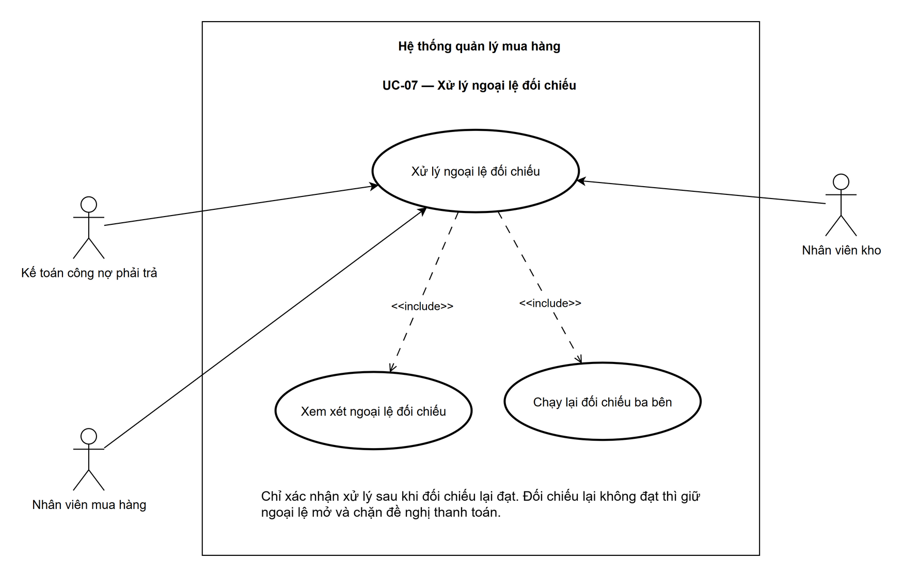

### Tóm tắt ca sử dụng

| Nội dung | Mô tả |
|---|---|
| **Mã ca sử dụng** | UC-07 |
| **Tên ca sử dụng** | Xử lý ngoại lệ đối chiếu |
| **Tác nhân chính** | Kế toán công nợ phải trả |
| **Tác nhân hỗ trợ** | Nhân viên mua hàng, Nhân viên kho |
| **Mục tiêu** | Điều tra và xử lý trường hợp đối chiếu ba bên không đạt để giao dịch có thể được đánh giá lại. |
| **Sự kiện kích hoạt** | Hệ thống tạo ngoại lệ đối chiếu sau lần đối chiếu không đạt. |
| **BRQ liên quan** | BRQ-08, BRQ-09 |
| **Quy tắc nghiệp vụ liên quan** | BR-20, BR-21, BR-22, BR-25, BR-26 |

### Điều kiện tiên quyết

1. Có ngoại lệ đối chiếu.
2. Ngoại lệ gắn với giao dịch mua hàng.
3. Kế toán công nợ phải trả có quyền xem xét ngoại lệ.

### Luồng chính

1. Kế toán công nợ phải trả mở ngoại lệ đối chiếu.
2. Hệ thống hiển thị thông tin sai lệch và tham chiếu giao dịch liên quan.
3. Kế toán công nợ phải trả xem xét sai lệch.
4. Kế toán công nợ phải trả xác định nguyên nhân có khả năng xảy ra.
5. Kế toán công nợ phải trả phối hợp với Nhân viên mua hàng và/hoặc Nhân viên kho khi cần.
6. Thông tin liên quan được chỉnh sửa hoặc cập nhật qua quy trình nghiệp vụ phù hợp.
7. Hành động chỉnh sửa và lịch sử liên quan được ghi nhận; riêng việc này không làm ngoại lệ trở thành đã xử lý.
8. Kế toán công nợ phải trả bắt đầu hoặc yêu cầu đánh giá lại.
9. Hệ thống chạy lại logic đối chiếu ba bên áp dụng.
10. Kết quả hiện hành thỏa mãn quy tắc đối chiếu áp dụng.
11. Hệ thống ghi nhận ngoại lệ là đã xử lý sau lần đối chiếu lại đạt đó.
12. Hóa đơn trở thành đủ điều kiện chuẩn bị và gửi đề nghị thanh toán.

### Luồng thay thế A1 — Ngoại lệ vẫn chưa xử lý xong

1. Hệ thống chạy lại đối chiếu.
2. Các chứng từ vẫn chưa thỏa mãn quy tắc đối chiếu áp dụng.
3. Ngoại lệ vẫn mở hoặc chưa xử lý xong.
4. Giao dịch vẫn bị chặn chuẩn bị đề nghị thanh toán thông thường.
5. Cần điều tra thêm.

### Luồng thay thế A2 — Cần nhà cung cấp làm rõ

1. Kế toán công nợ phải trả hoặc bộ phận mua hàng xác định cần Nhà cung cấp làm rõ.
2. Nhà cung cấp được liên hệ bên ngoài mô hình tương tác hệ thống nội bộ.
3. Thông tin liên quan được thu thập.
4. Thông tin giao dịch nội bộ được cập nhật phù hợp.
5. Đối chiếu được chạy lại.

### Điều kiện sau

**Đã xử lý** — Kết quả đối chiếu lại đạt được ghi nhận, sau đó cập nhật trạng thái ngoại lệ và lịch sử xử lý; hóa đơn được phép tiếp tục theo quy tắc áp dụng.

**Chưa xử lý xong** — Ngoại lệ vẫn còn hiệu lực và hóa đơn vẫn bị chặn chuẩn bị thanh toán thông thường.

### Quyết định còn mở

- **OD-04:** Chính sách và giá trị dung sai đối chiếu, nếu áp dụng.
- **OD-05:** Quy tắc chuyển cấp ngoại lệ đối chiếu.
- **OD-08:** Chính sách nhận hàng một phần có thể ảnh hưởng ngoại lệ liên quan số lượng.

### Ghi chú

- Nhà cung cấp có thể tham gia vận hành qua trao đổi bên ngoài nhưng không được mô hình hóa là tác nhân hệ thống trực tiếp.
- Kế toán công nợ phải trả vẫn là người phụ trách chính xử lý ngoại lệ đối chiếu trong đường cơ sở này.
- Chỉnh sửa PO đã phê duyệt/đã phát hành hoặc GR đã ghi không được đặc tả là sửa trực tiếp trong ca sử dụng này; quy trình chỉnh sửa áp dụng vẫn còn mở.

---

## UC-08 — Chuẩn bị đề nghị thanh toán

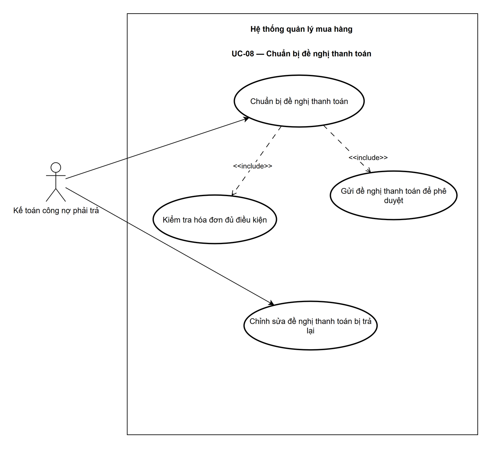

### Tóm tắt ca sử dụng

| Nội dung | Mô tả |
|---|---|
| **Mã ca sử dụng** | UC-08 |
| **Tên ca sử dụng** | Chuẩn bị đề nghị thanh toán |
| **Tác nhân chính** | Kế toán công nợ phải trả |
| **Mục tiêu** | Chuẩn bị và gửi đề nghị thanh toán cho hóa đơn đã thỏa mãn các kiểm soát mua hàng bắt buộc. |
| **Sự kiện kích hoạt** | Hóa đơn trở thành đủ điều kiện chuẩn bị thanh toán. |
| **BRQ liên quan** | BRQ-01, BRQ-10, BRQ-09 |
| **Quy tắc nghiệp vụ liên quan** | BR-19, BR-22, BR-25, BR-26 |

### Điều kiện tiên quyết

1. Hóa đơn nhà cung cấp tồn tại.
2. Hóa đơn đủ điều kiện chuẩn bị thanh toán.
3. Kết quả đối chiếu hiện hành thỏa mãn quy tắc áp dụng; ghi nhận ngoại lệ đã xử lý mà không có đối chiếu lại đạt là chưa đủ.
4. Kế toán công nợ phải trả có quyền chuẩn bị đề nghị thanh toán.

### Luồng chính

1. Kế toán công nợ phải trả xác định hóa đơn đủ điều kiện.
2. Kế toán công nợ phải trả yêu cầu bắt đầu chuẩn bị đề nghị thanh toán.
3. Hệ thống xác minh kết quả đối chiếu hiện hành đạt và điều kiện hóa đơn trước khi cho phép chuẩn bị, rồi kiểm tra lại trước khi gửi.
4. Hệ thống cung cấp tham chiếu giao dịch mua hàng liên quan và thông tin hỗ trợ.
5. Kế toán công nợ phải trả hoàn thiện thông tin đề nghị thanh toán.
6. Kế toán công nợ phải trả xem xét đề nghị thanh toán.
7. Kế toán công nợ phải trả gửi đề nghị thanh toán để phê duyệt.
8. Hệ thống ghi hành động gửi.
9. Hệ thống chuyển đề nghị thanh toán đến người phê duyệt tài chính có thẩm quyền.

### Luồng thay thế A1 — Hóa đơn chưa đủ điều kiện

1. Kế toán công nợ phải trả thử chuẩn bị hoặc gửi đề nghị thanh toán.
2. Hệ thống phát hiện thiếu dữ liệu đối chiếu, kết quả hiện hành không đạt hoặc trạng thái ngoại lệ không có đối chiếu lại đạt.
3. Chuẩn bị và gửi đề nghị thanh toán bị chặn.
4. Phải khắc phục vấn đề nền tảng và chạy lại đối chiếu đạt trước khi thử chuẩn bị hoặc gửi lần mới.

### Luồng thay thế A2 — Đề nghị thanh toán bị trả về

1. Trưởng bộ phận tài chính trả đề nghị thanh toán qua UC-09.
2. Kế toán công nợ phải trả mở đề nghị bị trả về.
3. Kế toán công nợ phải trả xem lý do trả về.
4. Kế toán công nợ phải trả chỉnh sửa thông tin bắt buộc.
5. Kế toán công nợ phải trả gửi lại đề nghị thanh toán.
6. Đề nghị được chuyển lại để phê duyệt.

### Điều kiện sau

- Đề nghị thanh toán hợp lệ đã được gửi phê duyệt tài chính.
- Lịch sử gửi được giữ.

### Ghi chú

- Chuẩn bị đề nghị thanh toán được chủ ý tách khỏi xử lý hóa đơn nhà cung cấp vì là mục tiêu người dùng và điểm kiểm soát riêng.

---

## UC-09 — Xem xét đề nghị thanh toán

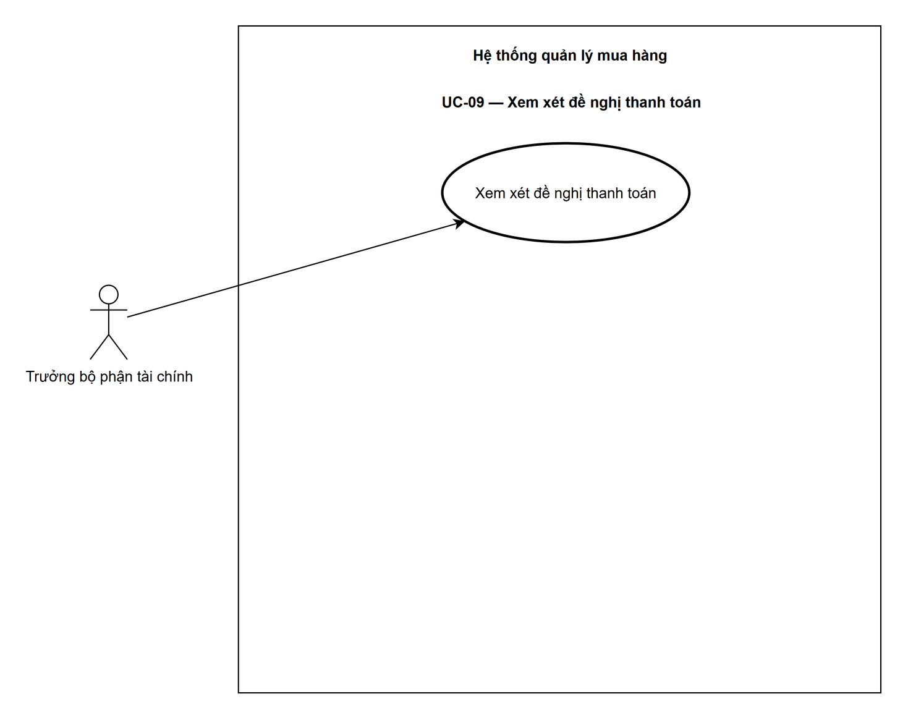

### Tóm tắt ca sử dụng

| Nội dung | Mô tả |
|---|---|
| **Mã ca sử dụng** | UC-09 |
| **Tên ca sử dụng** | Xem xét đề nghị thanh toán |
| **Tác nhân chính** | Trưởng bộ phận tài chính |
| **Mục tiêu** | Xem xét đề nghị thanh toán đã gửi và đưa ra quyết định phê duyệt cuối cùng trong phạm vi dự án. |
| **Sự kiện kích hoạt** | Đề nghị thanh toán được gửi và chuyển đến Tài chính. |
| **BRQ liên quan** | BRQ-01 (hỗ trợ điểm kết thúc phê duyệt), BRQ-10, BRQ-09 |
| **Quy tắc nghiệp vụ liên quan** | BR-23, BR-24, BR-25, BR-26 |

### Điều kiện tiên quyết

1. Đề nghị thanh toán đã được gửi.
2. Đề nghị liên kết với hóa đơn nhà cung cấp đủ điều kiện và giao dịch mua hàng hỗ trợ.
3. Trưởng bộ phận tài chính có thẩm quyền phê duyệt.

### Luồng chính — Phê duyệt đề nghị thanh toán

1. Trưởng bộ phận tài chính mở đề nghị thanh toán đang chờ.
2. Hệ thống hiển thị đề nghị thanh toán và thông tin giao dịch hỗ trợ liên quan.
3. Trưởng bộ phận tài chính xem xét đề nghị.
4. Trưởng bộ phận tài chính chọn **Phê duyệt**.
5. Hệ thống ghi quyết định phê duyệt, người phê duyệt và dấu thời gian.
6. Đề nghị thanh toán được cập nhật sang trạng thái đã phê duyệt áp dụng.
7. Luồng mua hàng đạt điểm kết thúc đã xác định.

### Luồng thay thế A1 — Trả đề nghị thanh toán để chỉnh sửa

1. Trưởng bộ phận tài chính xem xét đề nghị thanh toán.
2. Trưởng bộ phận tài chính xác định nội dung cần chỉnh sửa hoặc làm rõ.
3. Trưởng bộ phận tài chính chọn **Trả lại để chỉnh sửa**.
4. Hệ thống ghi quyết định và lý do/nhận xét liên quan.
5. Đề nghị trở về Kế toán công nợ phải trả.
6. Kế toán công nợ phải trả chỉnh sửa và gửi lại qua UC-08.

### Điều kiện sau

**Đã phê duyệt** — Đề nghị thanh toán được phê duyệt, lịch sử phê duyệt được giữ và phạm vi nghiên cứu tình huống mua hàng đã xác định hoàn tất.

**Đã trả về** — Đề nghị được trả về AP để chỉnh sửa.

### Ghi chú

- **Đề nghị thanh toán đã được phê duyệt là điểm kết thúc phạm vi dự án.** Trạng thái này không biểu thị đã thanh toán, đã thực hiện qua ngân hàng hoặc Nhà cung cấp đã nhận tiền.
- Thực hiện thanh toán ngân hàng thực tế, tích hợp API ngân hàng và đối soát thanh toán nằm ngoài phạm vi.

---

## UC-10 — Xem trạng thái giao dịch

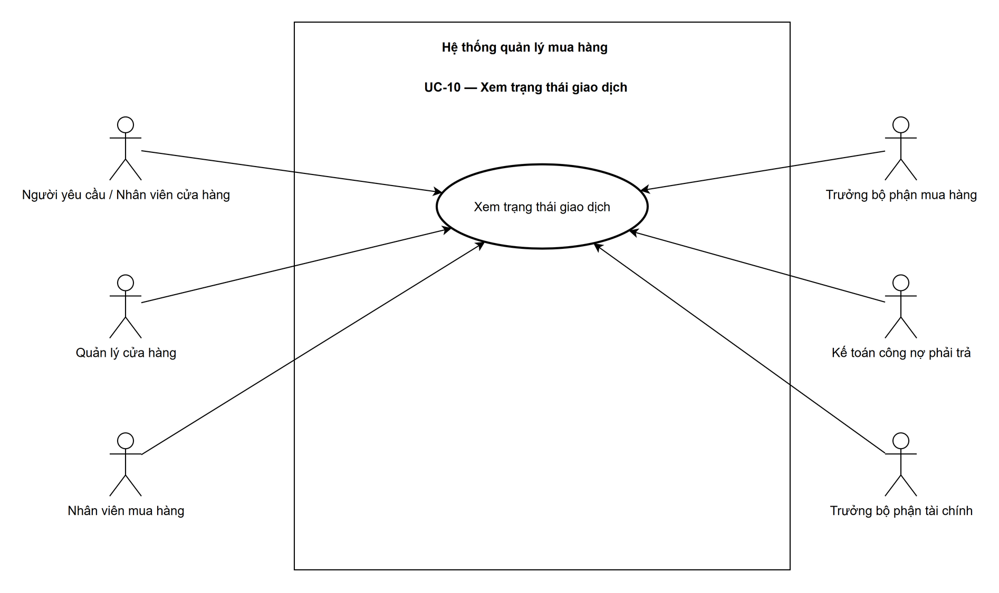

### Tóm tắt ca sử dụng

| Nội dung | Mô tả |
|---|---|
| **Mã ca sử dụng** | UC-10 |
| **Tên ca sử dụng** | Xem trạng thái giao dịch |
| **Tác nhân chính** | Người dùng vận hành được cấp quyền |
| **Mục tiêu** | Xem trạng thái hiện tại và vị trí trong luồng công việc của giao dịch mua hàng liên quan. |
| **Sự kiện kích hoạt** | Người dùng được cấp quyền cần xác định trạng thái hiện tại của giao dịch mua hàng. |
| **BRQ liên quan** | BRQ-07, BRQ-06 |
| **Quy tắc nghiệp vụ liên quan** | BR-25, BR-27 |

### Người dùng vận hành được cấp quyền trong đường cơ sở hiện tại

- Người yêu cầu / Nhân viên cửa hàng
- Quản lý cửa hàng
- Nhân viên mua hàng
- Trưởng bộ phận mua hàng
- Kế toán công nợ phải trả
- Trưởng bộ phận tài chính

Khả năng xem thực tế có thể khác nhau theo vai trò và quyền.

### Điều kiện tiên quyết

1. Người dùng đã được xác thực.
2. Người dùng có quyền truy cập thông tin giao dịch liên quan.
3. Giao dịch mua hàng được yêu cầu tồn tại.

### Luồng chính

1. Người dùng mở chức năng theo dõi hoặc tìm kiếm giao dịch.
2. Người dùng xác định giao dịch mua hàng liên quan.
3. Hệ thống kiểm tra quyền truy cập của người dùng.
4. Hệ thống hiển thị trạng thái giao dịch hiện tại.
5. Hệ thống hiển thị thông tin luồng công việc liên quan, có thể gồm bước quy trình hiện tại, hành động đang chờ, trạng thái phê duyệt, trạng thái bị trả về hoặc từ chối và tham chiếu PR/PO/GR/hóa đơn/đề nghị thanh toán liên quan tùy trường hợp.
6. Người dùng xem thông tin.

### Luồng thay thế A1 — Không tìm thấy giao dịch

1. Người dùng tìm giao dịch.
2. Không tìm thấy giao dịch khớp và có quyền truy cập.
3. Hệ thống thông báo không có kết quả liên quan.

### Luồng thay thế A2 — Không có quyền truy cập

1. Người dùng thử truy cập giao dịch.
2. Hệ thống xác định người dùng không có quyền bắt buộc.
3. Thông tin giao dịch bị hạn chế không được hiển thị.

### Điều kiện sau

- Không giao dịch nghiệp vụ nào bị sửa đổi.
- Người dùng nhận thông tin trạng thái hiện tại được vai trò cho phép.

### Quyết định còn mở

- **OD-06:** Mô hình trạng thái giao dịch mua hàng cuối cùng.
- **OD-07:** Quyền chi tiết theo vai trò.

### Ghi chú

- Danh sách và tên trạng thái chi tiết được chủ ý chưa chốt ở giai đoạn này.

---

## UC-11 — Xem lịch sử giao dịch

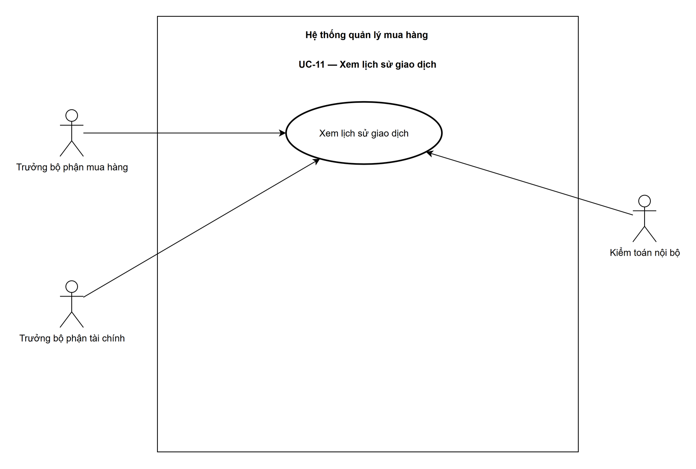

### Tóm tắt ca sử dụng

| Nội dung | Mô tả |
|---|---|
| **Mã ca sử dụng** | UC-11 |
| **Tên ca sử dụng** | Xem lịch sử giao dịch |
| **Tác nhân chính** | Trưởng bộ phận mua hàng, Trưởng bộ phận tài chính, Kiểm toán nội bộ |
| **Mục tiêu** | Xem xét lịch sử hành động, phê duyệt và ngoại lệ gắn với giao dịch mua hàng trong phạm vi. |
| **Sự kiện kích hoạt** | Người xem xét được cấp quyền cần điều tra hoặc xác minh lịch sử giao dịch. |
| **BRQ liên quan** | BRQ-09 |
| **Quy tắc nghiệp vụ liên quan** | BR-21, BR-26, BR-27 |

### Điều kiện tiên quyết

1. Người dùng đã được xác thực.
2. Người dùng có quyền xem lịch sử giao dịch liên quan.
3. Có giao dịch mua hàng liên quan.

### Luồng chính

1. Người xem xét tìm hoặc mở giao dịch mua hàng.
2. Hệ thống xác minh quyền truy cập của người xem xét.
3. Người xem xét mở lịch sử giao dịch.
4. Hệ thống hiển thị lịch sử có sẵn theo thứ tự thời gian hoặc thứ tự khác dễ hiểu.
5. Lịch sử hiển thị có thể gồm người dùng/tác nhân, hành động thực hiện, dấu thời gian, quyết định phê duyệt, trạng thái trước/mới tùy trường hợp, sự kiện ngoại lệ đối chiếu, thông tin xử lý ngoại lệ và tham chiếu giao dịch liên quan.
6. Người xem xét kiểm tra lịch sử.

### Luồng thay thế A1 — Không có lịch sử được phép truy cập

1. Người xem xét chọn giao dịch.
2. Không có lịch sử hoặc không được phép truy cập theo quyền hiện tại.
3. Hệ thống hiển thị thông tin phù hợp mà không để lộ dữ liệu bị hạn chế.

### Điều kiện sau

- Lịch sử giao dịch giữ nguyên.
- Người xem xét nhận thông tin kiểm toán được vai trò cho phép.

### Quyết định còn mở

- **OD-07:** Quyền chi tiết theo vai trò.

### Ghi chú

- Lịch sử giao dịch là chỉ đọc đối với các tác nhân được mô hình hóa trong ca sử dụng này.
- Các vai trò vận hành khác có thể được cấp quyền xem lịch sử hạn chế sau này nếu chủ sở hữu nghiệp vụ phê duyệt.

---

## UC-12 — Xem báo cáo mua hàng

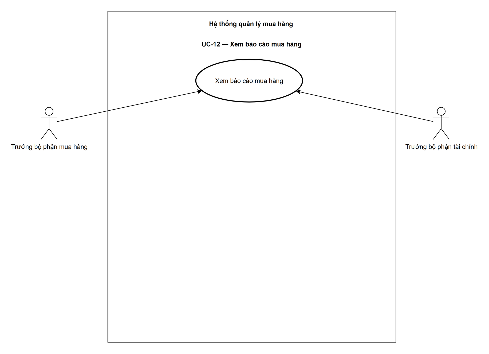

### Tóm tắt ca sử dụng

| Nội dung | Mô tả |
|---|---|
| **Mã ca sử dụng** | UC-12 |
| **Tên ca sử dụng** | Xem báo cáo mua hàng |
| **Tác nhân chính** | Trưởng bộ phận mua hàng, Trưởng bộ phận tài chính |
| **Mục tiêu** | Xem thông tin mua hàng vận hành cơ bản để theo dõi quy trình và phục vụ quản lý xem xét. |
| **Sự kiện kích hoạt** | Quản lý cần thông tin mua hàng tổng hợp. |
| **BRQ liên quan** | BRQ-11, BRQ-07 (hỗ trợ tổng hợp trạng thái) |
| **Quy tắc nghiệp vụ liên quan** | BR-25, BR-27 |

### Điều kiện tiên quyết

1. Người dùng đã được xác thực.
2. Người dùng có quyền truy cập báo cáo mua hàng.
3. Có dữ liệu giao dịch mua hàng liên quan.

### Luồng chính

1. Quản lý mở chức năng báo cáo mua hàng.
2. Hệ thống xác minh quyền truy cập của người dùng.
3. Hệ thống trình bày các báo cáo hoặc tổng hợp mua hàng cơ bản có sẵn.
4. Quản lý chọn báo cáo hoặc tập thông tin cần thiết.
5. Quản lý áp dụng các tiêu chí lọc có sẵn tùy trường hợp.
6. Hệ thống trình bày thông tin vận hành được yêu cầu.
7. Quản lý xem kết quả.

### Chủ đề báo cáo trong đường cơ sở nghiệp vụ hiện tại

Khả năng báo cáo cơ bản có thể bao phủ thông tin vận hành như trạng thái yêu cầu mua hàng, trạng thái đơn đặt hàng, yêu cầu chờ phê duyệt, hoạt động/trạng thái phiếu nhận hàng, trạng thái hóa đơn nhà cung cấp, ngoại lệ đối chiếu và trạng thái đề nghị thanh toán.

### Luồng thay thế A1 — Không có dữ liệu cho tiêu chí đã chọn

1. Quản lý chọn tiêu chí báo cáo.
2. Không có dữ liệu giao dịch được phép truy cập khớp tiêu chí.
3. Hệ thống hiển thị kết quả rỗng hoặc thông báo không có dữ liệu phù hợp.

### Luồng thay thế A2 — Truy cập báo cáo không có quyền

1. Người dùng thử truy cập thông tin báo cáo bị hạn chế.
2. Hệ thống xác định người dùng không có quyền bắt buộc.
3. Thông tin bị hạn chế không được hiển thị.

### Điều kiện sau

- Không giao dịch mua hàng nào bị sửa đổi.
- Quản lý nhận thông tin vận hành được phép.

### Ghi chú

- Bố cục bảng điều khiển, loại biểu đồ, định dạng xuất, công thức KPI và thiết kế trực quan chính xác chưa được xác định ở giai đoạn này.
- Yêu cầu báo cáo chi tiết sẽ được làm rõ trong các giai đoạn SRS và giao diện/khung giao diện.

---

# 4. Tổng hợp mức độ bao phủ từ BRQ đến ca sử dụng

| Yêu cầu nghiệp vụ | Ca sử dụng liên quan |
|---|---|
| BRQ-01 — Quản lý giao dịch P2P liên thông | UC-01, UC-03, UC-05, UC-06, UC-08; UC-09 hỗ trợ điểm kết thúc phê duyệt |
| BRQ-02 — Quản lý yêu cầu mua hàng chuẩn hóa | UC-01, UC-02 |
| BRQ-03 — Kiểm soát ngân sách bắt buộc | UC-01, UC-02 |
| BRQ-04 — Lựa chọn nhà cung cấp có kiểm soát | UC-03 |
| BRQ-05 — Quản lý và phê duyệt đơn đặt hàng chuẩn hóa | UC-03, UC-04 |
| BRQ-06 — Tái sử dụng dữ liệu mua hàng và liên kết giao dịch | UC-03, UC-05, UC-06, UC-10 |
| BRQ-07 — Khả năng theo dõi trạng thái mua hàng | UC-10; UC-12 hỗ trợ tổng hợp trạng thái |
| BRQ-08 — Đối chiếu ba bên và xử lý ngoại lệ có kiểm soát | UC-05, UC-06, UC-07 |
| BRQ-09 — Truy vết giao dịch và phê duyệt | UC-01–UC-09 là hành vi xuyên suốt, UC-11 là chức năng xem xét riêng |
| BRQ-10 — Phê duyệt đề nghị thanh toán có kiểm soát | UC-08, UC-09 |
| BRQ-11 — Báo cáo mua hàng cơ bản | UC-12 |

---

# 5. Ghi chú phạm vi và mô hình hóa

- Quy trình bắt đầu khi Người yêu cầu được cấp quyền xác định nhu cầu mua hàng và lập yêu cầu mua hàng.
- Quy trình được mô hình hóa kết thúc khi đề nghị thanh toán được phê duyệt.
- Thực hiện thanh toán ngân hàng thực tế nằm ngoài phạm vi.
- Lựa chọn nhà cung cấp giới hạn ở nhà cung cấp hiện có đã được phê duyệt.
- Tiếp nhận, đánh giá điều kiện nhà cung cấp, RFQ/RFP, đấu thầu và cổng thông tin nhà cung cấp nằm ngoài phạm vi.
- Lập và duy trì ngân sách nằm ngoài phạm vi; Hệ thống quản lý mua hàng sử dụng thông tin ngân sách có sẵn.
- Ngưỡng phê duyệt PO chi tiết vẫn còn mở.
- Tiêu chí phê duyệt tài chính chi tiết vẫn còn mở.
- Dung sai đối chiếu có điều kiện, không được giả định nếu chưa được phê duyệt.
- Chính sách nhận hàng một phần vẫn còn mở.
- Trạng thái giao dịch chính xác và quyền chi tiết theo vai trò sẽ được làm rõ sau.
- SRS sẽ chứa yêu cầu chức năng và phi chức năng chi tiết được rút ra từ các ca sử dụng nghiệp vụ này.
