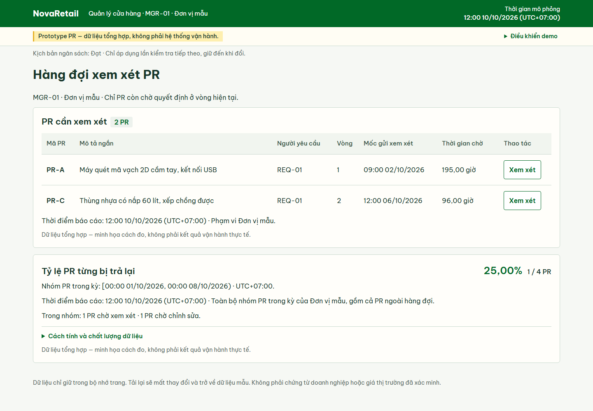
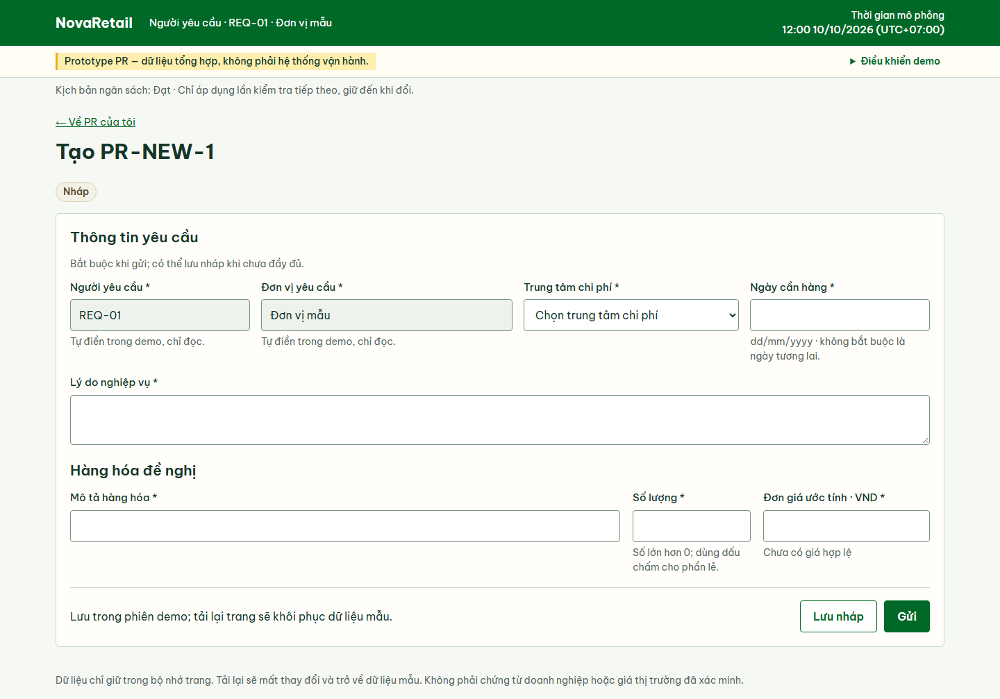

# NovaRetail JSC — Nghiên cứu tình huống phân tích nghiệp vụ P2P

## 1. Tổng quan dự án

NovaRetail JSC là **doanh nghiệp bán lẻ giả lập tại Việt Nam** trong nghiên cứu tình huống phân tích quy trình mua hàng đến thanh toán (Procure-to-Pay — P2P). Bài toán là thông tin mua hàng nằm rải rác trong bảng tính, email và hồ sơ của từng bộ phận, khiến việc phê duyệt và đối chiếu chứng từ phải chờ trao đổi thủ công.

Tôi phân tích quy trình hiện tại, đề xuất cách xử lý từng bước và viết yêu cầu phần mềm kèm tiêu chí chấp nhận.

**Xem sản phẩm:** [Tài liệu yêu cầu nghiệp vụ (BRD)](./05-brd/business-requirements-document.md) · [Sơ đồ quy trình đề xuất](./assets/diagrams/exports/to-be/p2p-to-be.png) · [Wireframe tĩnh PR](./wireframes/pr/README.md) · [Prototype PR và hướng dẫn chạy](./prototype/pr/README.md) · [Kết quả kiểm chứng prototype](./prototype/pr/verification.md).

## 2. Bài toán nghiệp vụ

- Yêu cầu phê duyệt được gửi qua email; các bộ phận phải hỏi lại để biết chứng từ đang chờ ai xử lý.
- Thông tin từ PR có thể phải nhập lại khi lập đơn đặt hàng (Purchase Order — PO); hồ sơ mua hàng, kho và kế toán được lưu riêng.
- Kế toán phải thu thập PO, phiếu nhận hàng (Goods Receipt — GR) và hóa đơn để đối chiếu ba bên thủ công. Thiếu chứng từ hoặc có sai lệch làm chậm bước chuẩn bị đề nghị thanh toán.

Chi tiết vấn đề và nguyên nhân nằm trong [phát biểu vấn đề](./01-business-context/problem-statement.md) và [phân tích hiện trạng](./03-as-is-analysis/README.md).

## 3. Vai trò và công việc thực hiện

Trong case study này, tôi thực hiện các công việc sau:

- Xác định vấn đề và phạm vi; mô tả vai trò của các bên liên quan và bảng phân công trách nhiệm (RACI).
- Thể hiện các bước bàn giao, phê duyệt và xử lý sai lệch bằng sơ đồ quy trình hiện tại (As-Is) và quy trình đề xuất (To-Be).
- Viết quy tắc nghiệp vụ, BRD và các ca sử dụng (Use Case — UC) với điều kiện trước, luồng chính và nhánh thay thế.
- Nối yêu cầu nghiệp vụ với yêu cầu phần mềm, UC và tiêu chí chấp nhận (Acceptance Criteria — AC) trong ma trận truy vết yêu cầu (RTM).

## 4. Phạm vi

**Trong phạm vi phân tích:** mua hàng hóa hữu hình, từ lập PR đến phê duyệt đề nghị thanh toán. Các bước gồm xem xét PR, lập và phê duyệt PO, ghi GR, xử lý hóa đơn, đối chiếu và xử lý ngoại lệ. Tài liệu cũng mô tả yêu cầu xem trạng thái, lịch sử giao dịch và báo cáo mua hàng.

**Ngoài phạm vi:** mua dịch vụ, thực hiện thanh toán ngân hàng, tiếp nhận nhà cung cấp mới và tìm nguồn cung, quản lý kho chi tiết, xử lý thuế, kế toán đầy đủ và thay thế hệ thống quản trị doanh nghiệp (ERP). Điểm kết thúc là đề nghị thanh toán được phê duyệt; việc chuyển tiền nằm ngoài quy trình này. Xem [phạm vi chi tiết](./01-business-context/scope.md).

## 5. Giải pháp đề xuất

Hệ thống quản lý mua hàng được đề xuất sẽ lưu liên kết giữa PR, PO, GR và hóa đơn. Sơ đồ To-Be thể hiện người xử lý từng bước, điều kiện chuyển bước và các nhánh trả lại hoặc chờ bổ sung thông tin.

Xem [sơ đồ To-Be](./assets/diagrams/exports/to-be/p2p-to-be.png), [nguồn Draw.io](./assets/diagrams/sources/to-be/p2p-to-be.drawio) và [quy tắc nghiệp vụ](./04-to-be-design/business-rules.md) để đối chiếu các điều kiện này.

## 6. Sản phẩm và hướng dẫn đọc

**Tài liệu phân tích.** Mở BRD để đọc nhu cầu và phạm vi chung. Dùng bảng dưới đây để tìm tài liệu theo phần việc cần xem.

| Phần việc | Sản phẩm trong repo |
| --- | --- |
| [Bối cảnh nghiệp vụ](./01-business-context/README.md) | Vấn đề, mục tiêu và phạm vi nghiên cứu. |
| [Các bên liên quan](./02-stakeholder-analysis/README.md) | Phân tích vai trò; [danh sách các bên liên quan](./02-stakeholder-analysis/P2P_Stakeholder_Register.xlsx) và [RACI sơ bộ](./02-stakeholder-analysis/Preliminary_RACI_Matrix_P2P.xlsx). |
| [Quy trình hiện tại](./03-as-is-analysis/README.md) | Sơ đồ As-Is, các điểm bất cập và nguyên nhân gây chậm hoặc nhập liệu lặp. |
| [Quy trình đề xuất](./04-to-be-design/README.md) | Sơ đồ To-Be, so sánh với hiện trạng và các quy tắc chuyển bước. |
| [Yêu cầu nghiệp vụ](./05-brd/README.md) | BRD, danh mục yêu cầu và khung xem xét, ký duyệt. |
| [Phân tích hệ thống](./06-system-analysis/README.md) | [Đặc tả 12 UC chính](./06-system-analysis/use-case-specifications.md) và sơ đồ hoạt động. UC-00 là sơ đồ tổng quan, không tính vào 12 UC chính. |
| [Yêu cầu phần mềm](./07-software-requirements/README.md) | [Đặc tả yêu cầu phần mềm (SRS)](./07-software-requirements/srs.md): yêu cầu chức năng, phi chức năng và AC theo dạng Cho trước/Khi/Thì. |
| [Truy vết yêu cầu](./08-traceability/README.md) | [RTM](./08-traceability/requirements-traceability-matrix.md) nối yêu cầu với UC và AC, đồng thời ghi các phần cần bổ sung hoặc còn chờ quyết định. |

[Thiết kế phép đo PR](./08-traceability/pr-metrics-design.md) bổ sung cách xác định số PR đang chờ, thời gian chờ theo vòng xem xét và tỷ lệ PR từng bị trả lại.

**Wireframe tĩnh.** Bộ [wireframe PR](./wireframes/pr/README.md) có bốn màn hình: danh sách của Người yêu cầu, tạo/chỉnh sửa, chi tiết PR và hàng đợi của Quản lý cửa hàng. Tải repository về máy, sau đó mở [wireframes/pr/index.html](./wireframes/pr/index.html) bằng trình duyệt; các nút lưu, gửi và quyết định là mẫu tĩnh. Có thể xem nhanh qua [ảnh hàng đợi](./wireframes/pr/previews/pr-04-queue.png) hoặc [các ảnh tiêu biểu](./wireframes/pr/README.md#ảnh-tiêu-biểu). Hướng dẫn mở, ảnh và phạm vi kiểm tra được ghi trong [README wireframe](./wireframes/pr/README.md#kiểm-tra-và-giới-hạn).

**Prototype tương tác.** Bản [prototype PR](./prototype/pr/README.md) cho phép tạo và lưu PR, gửi và gửi lại, phê duyệt, trả lại, từ chối và xem lịch sử quy trình. Ba metric thể hiện số PR đang chờ xem xét, thời gian chờ theo vòng và tỷ lệ PR từng bị trả lại. Để thao tác, tải repository và làm theo [hướng dẫn chạy local](./prototype/pr/README.md#chạy-local); liên kết tài liệu trên GitHub không phải demo chạy trực tiếp. Dữ liệu chỉ tồn tại trong bộ nhớ trang; tải lại hoặc khôi phục sẽ đưa về dữ liệu mẫu.

Hai ảnh dưới đây được chụp trực tiếp trong cùng phiên kiểm tra trình duyệt, minh họa hai tình huống riêng. Nguồn ảnh, thời điểm chụp thực tế và kết quả nằm trong [README prototype](./prototype/pr/README.md#ảnh-trực-tiếp-hiện-hành) và [tài liệu kiểm chứng](./prototype/pr/verification.md).

**Dữ liệu tổng hợp — hàng đợi ban đầu, Quản lý cửa hàng (MGR-01), mốc mô phỏng 10/10/2026 12:00 UTC+07:00.**

**Dữ liệu tổng hợp — mở form tạo PR chưa lưu, Người yêu cầu (REQ-01), mốc mô phỏng 10/10/2026 12:00 UTC+07:00.**

Tra thuật ngữ tại [glossary](./glossary.md). [Các quyết định nghiệp vụ nền tảng](./08-traceability/baseline-decisions.md) giải thích ranh giới đã chọn; [danh mục sơ đồ](./assets/diagrams/sources/README.md) dẫn tới nguồn Draw.io và ảnh xuất.

## 7. Trạng thái và giới hạn

- Số liệu nghiệp vụ mô phỏng là **dữ liệu tổng hợp**. Các chỉ tiêu trong [mục tiêu dự án](./01-business-context/project-objectives.md) là **mục tiêu giả định**, chưa phải kết quả đo lợi ích vận hành.
- Vai trò và nhu cầu của các bên liên quan được giả định cho nghiên cứu tình huống. Chưa có phỏng vấn, xác nhận hoặc ký duyệt của các bên liên quan thực tế; [khung ký duyệt BRD](./05-brd/approval-and-signoff.md) chỉ mô tả việc cần làm.
- Đã có prototype PR và [kiểm chứng đạt trong phạm vi prototype đã xác định](./prototype/pr/verification.md); chưa triển khai vận hành, chưa kiểm thử chấp nhận người dùng (UAT) hoặc stakeholder sign-off. Kết quả này không đồng nghĩa 37 AC đã được kiểm thử đạt. Phân quyền demo, lịch sử quy trình và đồng hồ mô phỏng không chứng minh bảo mật, audit đầy đủ hoặc SLA thực tế.
- Các quyết định còn mở (Open Decision — OD) từ OD-01 đến OD-08 vẫn được ghi tại [RTM](./08-traceability/requirements-traceability-matrix.md), gồm chính sách ngân sách, phê duyệt tài chính bổ sung, dung sai đối chiếu và quyền chi tiết theo vai trò.
- Các khoảng trống bao phủ yêu cầu trong RTM vẫn còn mở. Phần được kiểm chứng một phần hoặc ngoài phạm vi prototype được ghi riêng trong tài liệu kiểm chứng; kết quả prototype không thay đổi coverage của SRS/RTM.
- Một số thông tin chứng từ trên wireframe chưa được bổ sung. Cần bổ sung và xem xét dữ liệu mẫu trước khi dùng giao diện để đánh giá một quyết định nghiệp vụ cụ thể.

## 8. Những điểm rút ra từ phân tích

- PR bị trả lại phải được kiểm tra lại thông tin và ngân sách trước khi chuyển xem xét. PR bị từ chối không có đường chỉnh sửa hoặc gửi lại trong phạm vi đã xác định.
- Mọi PO cần phê duyệt mua hàng; phê duyệt tài chính bổ sung chỉ áp dụng khi thỏa điều kiện chính sách. Hoàn tất phê duyệt mới làm PO đủ điều kiện phát hành; bước phát hành cho nhà cung cấp được ghi nhận riêng.
- Hóa đơn thiếu thông tin đối chiếu phải chờ bổ sung. Nếu có sai lệch, sau chỉnh sửa phải đối chiếu lại đạt mới xác nhận ngoại lệ đã xử lý. Cả chuẩn bị và gửi đề nghị thanh toán đều cần kết quả đối chiếu hiện hành đạt.
