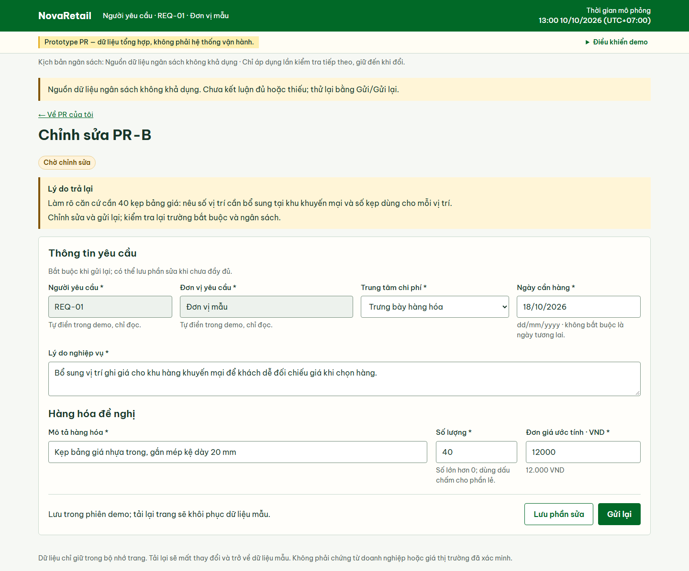
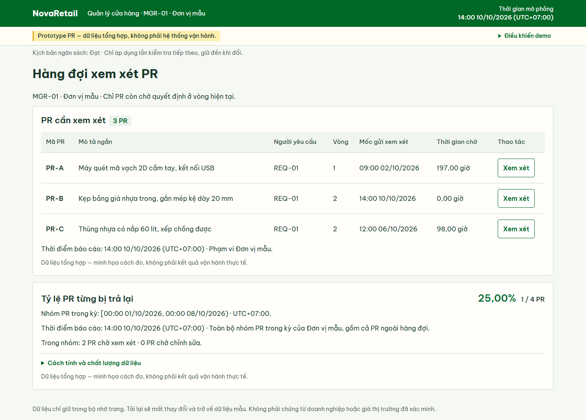

# NovaRetail — Phân tích quy trình P2P và prototype yêu cầu mua hàng

## 1. Giới thiệu bài toán và sản phẩm

NovaRetail là doanh nghiệp bán lẻ giả lập tại Việt Nam. Thông tin mua hàng nằm trong bảng tính, email và hồ sơ riêng, khiến các bộ phận phải hỏi lại trạng thái, có thể phải nhập lại dữ liệu và thu thập chứng từ để đối chiếu.

Tôi phân tích quy trình mua hàng đến thanh toán (P2P), từ tạo yêu cầu mua hàng (PR) đến phê duyệt đề nghị thanh toán. Prototype chỉ minh họa PR.

Phần ERP đã hoàn tất ở phạm vi phân tích và thiết kế: phân tích mức phù hợp của Odoo Community, thiết kế phần bổ sung cho kiểm soát G1-D01 và xây dựng 30 kịch bản kiểm chứng. Chưa triển khai hoặc kiểm chứng trên ERP; [README ERP lab](./10-erp-lab/README.md) ghi phạm vi và giới hạn, còn [thiết kế chi tiết](./10-erp-lab/lab-design.md) giữ các kết quả mong đợi chưa thực hiện.

Tôi thực hiện phân tích nghiệp vụ, xây dựng và rà soát tài liệu, vẽ sơ đồ, thiết kế UI và các hoạt động kiểm tra. Codex hỗ trợ triển khai code theo yêu cầu và các quyết định đã thống nhất.

[Thử demo PR](https://phuoctrong2005.github.io/retail-p2p-ba-case-study/) · [Hướng dẫn thử nhanh](./prototype/pr/README.md#hướng-dẫn-thử-nhanh) · [Tài liệu kiểm chứng](./prototype/pr/verification.md)

## 2. Bối cảnh, người sử dụng và phạm vi

Trong [quy trình To-Be](./04-to-be-design/README.md#5-mô-hình-bpmn-to-be), Người yêu cầu lập PR; Quản lý cửa hàng xem xét; Mua hàng xử lý đơn đặt hàng (PO); Kho ghi phiếu nhận hàng (GR); Kế toán công nợ đối chiếu hóa đơn; Tài chính phê duyệt đề nghị thanh toán.

Phân tích chỉ bao gồm hàng hóa hữu hình. Mua dịch vụ, thanh toán ngân hàng và thay thế toàn bộ hệ thống hoạch định nguồn lực doanh nghiệp (ERP) nằm ngoài phạm vi. Phê duyệt đề nghị thanh toán chưa có nghĩa nhà cung cấp đã nhận tiền.

Theo [quy ước vai trò và phạm vi demo](./06-system-analysis/pr-prototype-decisions.md#sim-03--hai-vai-trò-và-phạm-vi-dữ-liệu-demo), demo chỉ dùng Người yêu cầu REQ-01 và Quản lý MGR-01 trong một đơn vị mẫu. Chuyển vai giúp thử tình huống, không phải đăng nhập hoặc phân quyền thực tế.

## 3. Phân tích và ba quyết định quan trọng

### Làm rõ Reject và Return

Rà soát đường cơ sở nghiệp vụ cho thấy cách diễn đạt cũ coi từ chối và trả về tương đương. Tôi làm rõ hậu quả: từ chối dừng PR, không mở lại hoặc gửi lại chính PR đó; trả lại cần lý do, cho phép chỉnh sửa và gửi lại.

Sự phân biệt được chuyển thành hành vi: xác nhận hậu quả trước khi từ chối; hiển thị lý do và bước tiếp theo khi trả lại. [Các quyết định nghiệp vụ nền tảng](./08-traceability/baseline-decisions.md) ghi lựa chọn; [các kịch bản trả lại, gửi lại và từ chối](./prototype/pr/verification.md#pr-chk-06--trả-lại-thiếu-lý-do-và-trả-lại-hợp-lệ) ghi kết quả kiểm chứng tương ứng trong prototype.

### Chọn đúng mốc mở vòng xem xét

Bấm Gửi chưa đồng nghĩa PR đã đến người xem xét. Chỉ khi trường bắt buộc và ngân sách đạt, PR thực sự chuyển xem xét mới mở vòng. Sau trả lại, gửi lại phải qua các kiểm tra trước vòng tiếp theo; lưu phần sửa chưa mở vòng.

[Thiết kế metric](./08-traceability/pr-metrics-design.md#nguồn-và-ranh-giới) lấy mốc gửi hợp lệ để đo thời gian chờ vòng hiện tại. Tỷ lệ từng bị trả lại dùng nhóm PR theo lần gửi hợp lệ đầu tiên. Thiếu bằng chứng không được mặc định thành 0; ngân sách trong demo chỉ là kết quả định trước theo [quy ước mô phỏng ngân sách](./06-system-analysis/pr-prototype-decisions.md#sim-01--ngân-sách-mô-phỏng-có-thể-tái-lập).

### Giữ prototype trong phạm vi PR

Tôi giữ prototype trong phạm vi vừa sức: PR đủ để minh họa validation, quyết định, vòng chỉnh sửa và metric. Phân tích P2P vẫn giữ bức tranh liên kết chứng từ và kiểm soát ở các bước sau.

[Bốn màn hình PR](./06-system-analysis/pr-behavior-analysis.md#danh-mục-màn-hình-đề-xuất) nối yêu cầu với thao tác. PR đã duyệt chỉ sẵn sàng chuyển sang Mua hàng; prototype chưa tạo PO, GR, hóa đơn hoặc báo cáo P2P đầy đủ. Ranh giới này được ghi trong [phạm vi kiểm chứng](./prototype/pr/verification.md#phạm-vi-và-phiên-bản).

## 4. Giải pháp và bằng chứng kiểm chứng

PR-B đã bị trả lại để làm rõ nhu cầu. Theo [chuỗi thử nhanh](./prototype/pr/README.md#hướng-dẫn-thử-nhanh), gửi lại khi nguồn ngân sách không khả dụng giữ PR ở Chờ chỉnh sửa, chưa mở vòng. Đổi sang Đạt rồi gửi lại mới đưa B vào hàng đợi vòng 2.

**Dữ liệu tổng hợp — minh họa cách đo, không phải kết quả vận hành thực tế.** Hai ảnh cùng chuỗi mô phỏng ngày 10/10/2026, UTC+07:00; được chụp ngày 16/10/2026 theo [bảng nguồn ảnh](./prototype/pr/README.md#ảnh-trực-tiếp-hiện-hành).

**13:00 — REQ-01 gửi lại B nhưng nguồn ngân sách không khả dụng; PR vẫn Chờ chỉnh sửa.**

**14:00 — MGR-01 xem hàng đợi A/B/C; B đã gửi lại hợp lệ, vào vòng 2 với thời gian chờ 0 giờ.**

[Tài liệu kiểm chứng prototype](./prototype/pr/verification.md) ghi nhận kết quả kiểm tra logic, kịch bản nghiệp vụ và giao diện theo từng phiên bản, phạm vi. Đây là kết quả đã được ghi nhận, không phải kết quả vừa chạy lại. Kết quả không phải kiểm thử chấp nhận người dùng (UAT) hay xác nhận toàn bộ 37 tiêu chí chấp nhận (AC) đạt.

## 5. Kết quả, giới hạn, bài học và hướng tiếp theo

Kết quả hiện có gồm tài liệu nghiệp vụ, sơ đồ, thiết kế UI, prototype và bằng chứng kiểm chứng. [Ma trận truy vết yêu cầu (RTM)](./08-traceability/requirements-traceability-matrix.md) giúp lần theo yêu cầu và nhận diện khoảng thiếu; chưa đo lợi ích vận hành.

Dữ liệu là giả lập; chưa có ký duyệt của các bên liên quan hoặc UAT. Prototype lưu trong bộ nhớ trang, chưa chứng minh bảo mật hoặc lịch sử kiểm toán đầy đủ. Các quyết định còn mở (OD-01–08) và khoảng trống bao phủ yêu cầu vẫn còn. [Giới hạn kiểm chứng](./prototype/pr/verification.md#4-vấn-đề-phát-hiện-và-giới-hạn) nêu rõ phần chưa được chứng minh.

Ba bài học tôi rút ra:

- **Viết tài liệu chưa đủ để thấy hết lỗi:** kiểm tra UI đã dẫn tới sửa nút Xem xét và cách đặt thông tin chẩn đoán, được ghi trong [README prototype](./prototype/pr/README.md#hai-điểm-ui-đã-sửa-sau-review).
- **Reject và Return phải có hậu quả riêng:** khác biệt phải nhất quán từ quy tắc đến nút bấm, trạng thái và đường gửi lại.
- **Định nghĩa metric khó hơn chọn tên KPI:** cần chốt sự kiện, vòng, nhóm PR, mốc báo cáo và cách công bố dữ liệu thiếu.

Sau prototype, tôi đã bổ sung [so sánh ba hướng cải tiến P2P và kiến nghị có điều kiện](./09-solution-evaluation/options-assessment.md): chuẩn hóa công cụ hiện có, xây workflow riêng và sử dụng ERP phù hợp. Phân tích lấy kiểm soát mua hàng/hóa đơn (OBJ-04) làm ưu tiên dẫn dắt, với theo dõi dữ liệu và truy vết (OBJ-03/05) hỗ trợ; chưa đủ bằng chứng chọn giải pháp cuối cùng.

Tôi đã đối chiếu tài liệu và source Odoo Community 19.0 để phân tích phần chuẩn, cấu hình và khoảng thiếu; [thiết kế ERP](./10-erp-lab/lab-design.md) đề xuất phần bổ sung cho G1-D01 và 30 kịch bản về dữ liệu thiếu, ngoại lệ, tính hiện hành, kiểm tra riêng khi chuẩn bị/gửi, đồng thời và thử lại. Lab Mức A dự kiến dùng kết quả định trước để kiểm chứng cơ chế chặn, chưa kiểm chứng thuật toán đối chiếu ba bên. Chưa triển khai addon, tạo fixture trên ERP hoặc thực hiện 30 kịch bản; chưa chứng minh Odoo đáp ứng G1-D01, chưa có UAT hoặc kết quả vận hành ERP.

Chủ dự án chọn [chốt phần ERP ở phạm vi phân tích và thiết kế](./10-erp-lab/README.md) cho phiên bản portfolio này, sau kiểm kê cho thấy tài nguyên local hạn chế. Đây là quyết định phạm vi, không phải kết luận máy chắc chắn không chạy được Odoo. Triển khai và kiểm chứng thực tế là hướng mở rộng tùy chọn, cần được đánh giá và giao việc riêng; không còn là công việc bắt buộc đang chờ. Các đề xuất có điều kiện trong hồ sơ thiết kế/đánh giá được giữ nguyên như lịch sử phân tích, không phải kết quả đã chạy hoặc quyết định mua/triển khai ERP.

Toàn chuỗi P2P vẫn là bản đồ đối chiếu thiết kế; dữ liệu lab dự kiến là tổng hợp và không đòi hỏi có hệ thống kế toán/ngân sách thật. Chuẩn hóa công cụ hiện có có thể hỗ trợ chuyển tiếp nhưng chưa chứng minh đáp ứng các yêu cầu hệ thống tự kiểm tra/chặn. Các OD và khoảng trống bao phủ yêu cầu vẫn còn mở; kết quả prototype PR giữ nguyên phạm vi đã kiểm chứng riêng.
