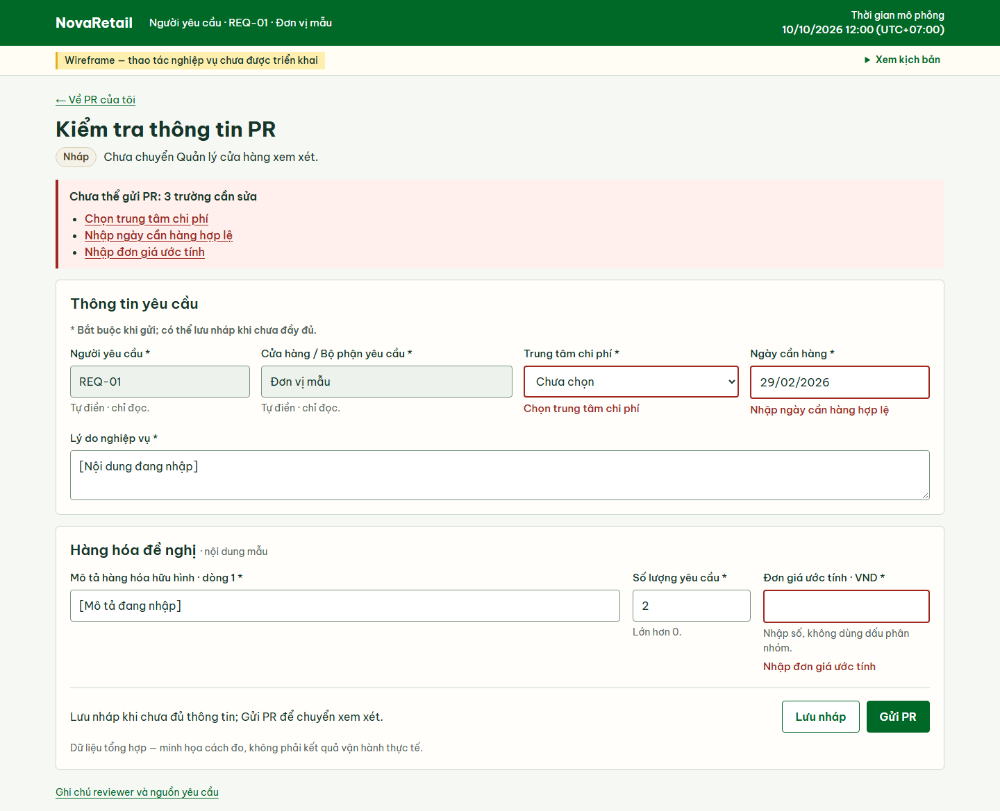
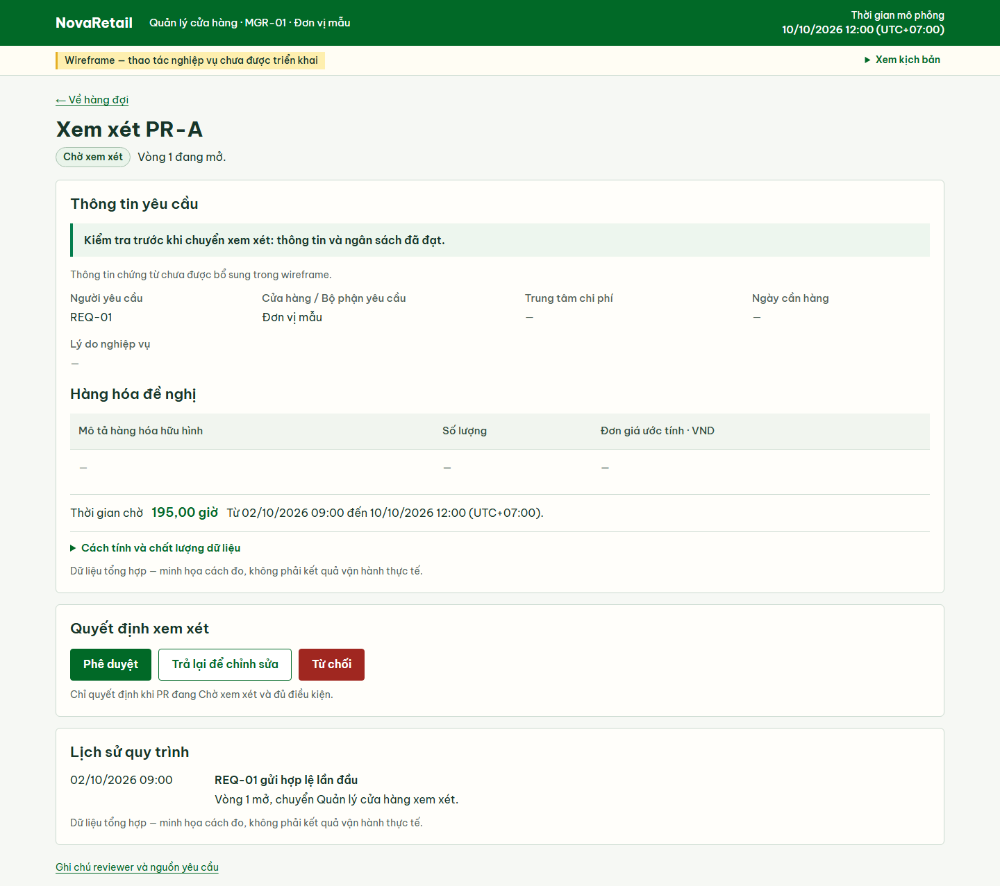
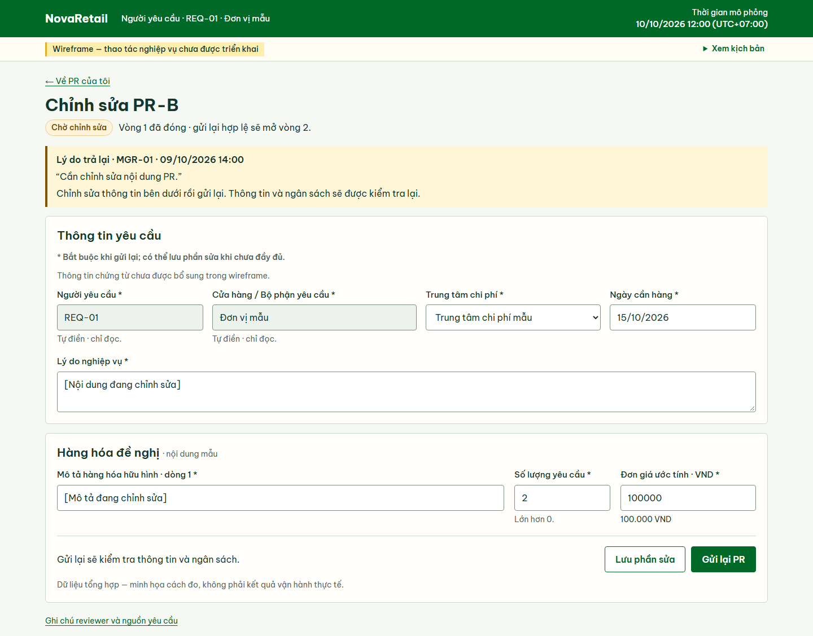
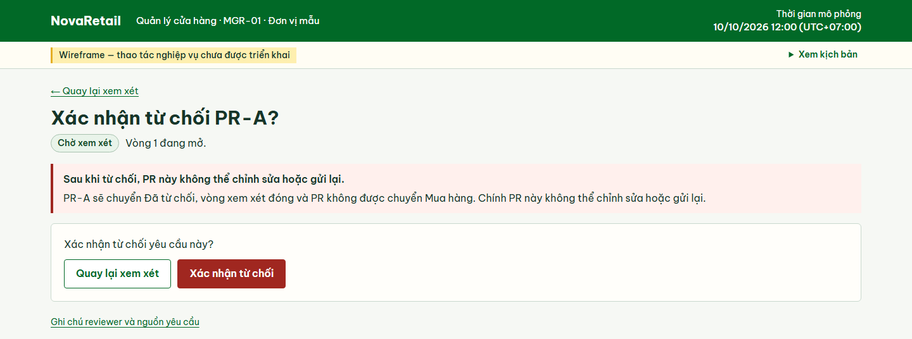

# Wireframe PR — giai đoạn 2C

Mở trực tiếp [index.html](./index.html) trong Chrome. Bộ chọn **Xem kịch bản** ở góc trên bên phải mở bốn màn hình và các biến thể; chọn lại tiêu đề bộ chọn để thu gọn. Liên kết chuyển góc xem, ô nhập cho phép thử gõ, còn nút nghiệp vụ là mẫu tĩnh. Dòng **“Wireframe — thao tác nghiệp vụ chưa được triển khai”** luôn có trên trang.

**Đây là wireframe tĩnh, chưa phải demo chức năng.** Ảnh preview phục vụ review giao diện và nội dung; các thao tác lưu, gửi, xem xét và quyết định chưa được triển khai.

Nguồn chỉnh sửa: `index.html` và `styles.css`. Font local và giấy phép giữ trong thư mục này. Không cần cài thư viện hoặc chạy server. Bộ ảnh hiện hành duy nhất nằm trong `previews/`; ảnh thử ở 1280 px, ảnh mở phần giải thích và hồ sơ trình duyệt đặt ngoài repository.

## Bố cục hiện hành

- Header gọn gồm thương hiệu, vai trò/người dùng, Đơn vị mẫu và mốc mô phỏng. Các trang chi tiết/form có đường về danh sách hoặc hàng đợi đúng vai trò; bỏ điều hướng lặp lại chính trang.
- Hàng đợi đặt bảng ngay dưới tiêu đề. Số **2 PR** đi cùng tiêu đề bảng; mô tả chưa trình bày dùng dấu gạch kèm chú thích wireframe. Nhãn chính là **Thời gian chờ**. Phần **Tỷ lệ PR từng bị trả lại** nằm bên dưới, giữ tử/mẫu số, kỳ, mốc báo cáo, phạm vi và hai số ngữ cảnh. Công thức, ID và số chất lượng dữ liệu ở **Cách tính và chất lượng dữ liệu**; cảnh báo dữ liệu chưa xác định vẫn hiện khi phần này đóng.
- Form dùng toàn chiều rộng, gồm **Thông tin yêu cầu** và **Hàng hóa đề nghị**. Mô tả hàng hóa nhận chiều rộng còn lại, số lượng rộng 170 px, đơn giá 240 px ở desktop. Trường cố định có nền xám, trường được sửa có nền trắng. Lý do trả lại và hướng dẫn ngắn nằm ngay trên form. Lưu/Gửi ở cuối form theo cùng thứ tự.
- Tám trường PR có dấu **\***. Form Nháp dùng hướng dẫn **“Bắt buộc khi gửi; có thể lưu nháp khi chưa đầy đủ.”**; PR-B Chờ chỉnh sửa và biến thể lỗi gửi lại dùng **“Bắt buộc khi gửi lại; có thể lưu phần sửa khi chưa đầy đủ.”** Lưu phần sửa giữ trạng thái Chờ chỉnh sửa, không đổi PR thành Nháp. Người yêu cầu và đơn vị vẫn tự điền/chỉ đọc, có chú thích riêng ngay dưới ô. `aria-required` và mô tả hỗ trợ thể hiện đúng điều kiện gửi/gửi lại; không thêm validation hoặc chặn lưu. Lý do trả lại bắt buộc khi hoàn tất quyết định trả lại, tách với điều kiện gửi PR.
- Giá trị nhập tiền vẫn là `100000`; dòng đọc **100.000 VND** là hiển thị tĩnh cùng giá trị. Không đưa dấu phân nhóm vào input vì 2B chỉ nhận dấu chấm thập phân, không nhận dấu phân nhóm. Không đổi validation hoặc triển khai định dạng tự động.
- Mã màn hình/mapping nằm trong tài liệu và thuộc tính nguồn HTML; ID metric chỉ xuất hiện trong phần giải thích thu gọn. Liên kết **Xem lỗi khi gửi lại** thuộc bộ chọn kịch bản.
- Cảnh báo xác nhận từ chối dùng **“Sau khi từ chối, PR này không thể chỉnh sửa hoặc gửi lại.”** để nêu chính xác đối tượng chịu hậu quả.

## Font thực tế và tỷ lệ

Giữ nguyên bốn file Be Vietnam Pro 400/500/600/700 và [OFL.txt](./OFL.txt). Đã kiểm tra bằng Chrome DevTools Protocol **`CSS.getPlatformFontsForNode`**, kết hợp computed weight/size. Với textarea, kiểm tra cả nút chữ trong shadow DOM của trình duyệt. Đây là font được dùng để vẽ glyph; không chỉ là tên khai báo trong CSS hay kết quả `document.fonts.check`.

| Thành phần được lấy mẫu | Kích thước / weight | Font thực tế (PostScript name) |
| --- | --- | --- |
| Tiêu đề trang có dấu, như “Tạo yêu cầu mua hàng” | 30 px / 700 | `BeVietnamPro-Bold` |
| Tiêu đề nhóm | 21 px / 600 | `BeVietnamPro-SemiBold` |
| Nội dung, dữ liệu bảng và ngày giờ | 16 px / 400 | `BeVietnamPro-Regular` |
| Nhãn và tiêu đề cột | 15 px / 500 | `BeVietnamPro-Medium` |
| Ô nhập “Đơn vị mẫu”, select và textarea tiếng Việt | 16 px / 400 | `BeVietnamPro-Regular` |
| Nút Lưu/Gửi | 16 px / 600 | `BeVietnamPro-SemiBold` |
| Chú thích | 14 px / 400 | `BeVietnamPro-Regular` |

Cả 20 mẫu font ở form, hàng đợi và trang trả lại đều dùng font custom Be Vietnam Pro đúng weight; không thấy fallback ngoài ý muốn trong các mẫu này. Nội dung có line-height 1,5; tiêu đề 1,2–1,35. Ô nhập và nút thường cao 46 px; hàng bảng hàng đợi khoảng 52–53 px. Không dùng zoom hoặc `transform: scale()` để tăng kích thước.

## Dữ liệu và placeholder

Mốc cơ sở: **10/10/2026 12:00, UTC+07:00**. Phạm vi giữ theo SIM-03: **REQ-01**, **MGR-01**, **Đơn vị mẫu**, năm PR-A–PR-E. Hàng đợi có PR-A **195,00 giờ**, PR-C **96,00 giờ**, tổng **2 PR**. Tỷ lệ trả lại là **1/4 = 25,00%** trên cohort toàn đơn vị **[01/10/2026 00:00, 08/10/2026 00:00)**. Trong cohort còn **1 PR chờ xem xét** và **1 PR chờ chỉnh sửa**. PR-C nằm trong hàng đợi nhưng ngoài cohort; PR-B/D/E vẫn thuộc cohort dù không ở hàng đợi.

Nội dung chứng từ PR-A–PR-E chưa được bổ sung vào phần trình bày wireframe. Danh sách/hàng đợi/chi tiết dùng dấu gạch và chú thích **“Thông tin chứng từ chưa được bổ sung trong wireframe.”**; form minh họa chỉnh sửa PR-B cũng có chú thích này. Dấu gạch chỉ phần chưa trình bày, không biểu thị PR đã gửi hợp lệ mà thiếu dữ liệu bắt buộc. Các mốc gửi hợp lệ và kết quả kiểm tra theo ví dụ đã review được giữ nguyên. Không gán nội dung mua hàng mới cho các PR này như dữ liệu được duyệt. Nội dung mẫu cần được bổ sung và review trước khi đánh giá đủ thông tin quyết định trên prototype.

Trên form, các chuỗi trong ngoặc vuông như `[Mô tả đang chỉnh sửa]` là **placeholder bố cục và nội dung đang nhập**. Các giá trị số/ngày có sẵn từ bản wireframe trước (`2`, `100000`, `15/10/2026`) tiếp tục chỉ phục vụ bố cục, không trở thành dữ liệu đã duyệt của PR-B hoặc dataset vận hành. Biến thể lỗi giữ phần nhập tương ứng của biến thể trước đó. “Trung tâm chi phí mẫu” là tham chiếu tối thiểu của demo, không phải danh mục doanh nghiệp.

Lý do **“Cần chỉnh sửa nội dung PR.”** được giữ từ chuỗi sự kiện mẫu đã review. Đây là **placeholder còn chung chung**, chưa phải ví dụ hoàn thiện về hướng dẫn trả lại. Cần thay bằng nội dung cụ thể đã được review khi chuẩn bị dữ liệu prototype; wireframe này không tự bổ sung lý do mới.

Các biến thể nháp/lỗi/hàng đợi trống/dữ liệu thiếu là **tình huống riêng**, không cộng vào PR-A–PR-E hoặc tính lại số tại mốc cơ sở. Các vùng số liệu giữ nhãn **“Dữ liệu tổng hợp — minh họa cách đo, không phải kết quả vận hành thực tế.”**

Metric giữ các phân biệt: **Không áp dụng** khi xác định PR không đang chờ; **Không xác định do thiếu dữ liệu** khi chưa đủ mốc tính thời gian; **Không có dữ liệu** khi mẫu số tính được bằng 0. Nếu mẫu số bằng 0 do chưa xác định cohort, cảnh báo phải nói rõ chưa thể kết luận nhóm thực sự rỗng. Thiếu định danh PR phải công bố số bản ghi không gắn được PR và giới hạn **Không xác định đầy đủ**. Không có thay đổi SIM, công thức metric hoặc phạm vi quyền; OD-03/06/07 vẫn mở theo tài liệu nguồn.

## Mapping đủ 18 hành vi

| Hành vi 2A | Màn hình / đích HTML | Nguồn trực tiếp |
| --- | --- | --- |
| PR-BHV-01 — tìm/chọn PR, vào tạo mới | PR-SCR-01 `#scr01`, PR-SCR-02 `#scr02` | UC-01/10; FR-14; SIM-03 |
| PR-BHV-02 — mở nháp | PR-SCR-02 `#draft` | FR-01; AC-25; G1-D05 |
| PR-BHV-03 — nhập tám trường | PR-SCR-02 `#scr02` và các form biến thể | UC-01; BR-01; SRS 2.1; SIM-03 |
| PR-BHV-04 — lưu nháp chưa đủ trường | PR-SCR-02 `#draft`, nhóm nút cuối form | FR-01; AC-01/25; SIM-04 |
| PR-BHV-05 — gửi thiếu/sai trường | PR-SCR-02 `#submit-error`, `#resubmit-error` | UC-01 A1; BR-01; FR-01; AC-01 |
| PR-BHV-06 — ngân sách không đạt | PR-SCR-02 `#budget-error` | UC-01 A2; BR-02/03; FR-02; AC-02/03 |
| PR-BHV-07 — lần gửi hợp lệ đầu | PR-SCR-03 `#waiting`, lịch sử vòng 1 | UC-01; FR-01/02; AC-01–03; SIM-02 |
| PR-BHV-08 — sửa/gửi lại sau trả lại | PR-SCR-02 `#returned`, `#resubmit-error`; PR-SCR-03 `#waiting-c` | UC-01 A3; UC-02 A2; BR-04; AC-06/34 |
| PR-BHV-09 — kết quả ngân sách mô phỏng | Bộ chọn kịch bản → `#scr02`, `#budget-error`, `#budget-unavailable` | SIM-01; OD-03 còn mở |
| PR-BHV-10 — chi tiết/trạng thái | PR-SCR-03 `#scr03`, `#waiting`, `#waiting-c`, `#approved`, `#rejected` | UC-10; BR-25/27; FR-14; AC-20/21 |
| PR-BHV-11 — lý do và bước chỉnh sửa | PR-SCR-03 `#scr03`; PR-SCR-02 `#returned` | UC-01/02; BR-04; FR-03; AC-06/34 |
| PR-BHV-12 — phê duyệt | PR-SCR-03 `#manager-review`, `#manager-review-c`, `#approved` | UC-02; BR-04/05; FR-03; AC-04 |
| PR-BHV-13 — từ chối và xác nhận | PR-SCR-03 `#manager-reject`, `#rejected` | UC-02 A1; FR-03; AC-05; G1-D03/D05 |
| PR-BHV-14 — trả lại có lý do bắt buộc | PR-SCR-03 `#manager-return`; PR-SCR-02 `#returned` | UC-02 A2; BR-04; AC-06/34 |
| PR-BHV-15 — lịch sử quy trình được phép xem | PR-SCR-03, phần lịch sử của các PR | UC-11; FR-15; AC-22; SIM-03 |
| PR-BHV-16 — chi tiết theo vai trò | PR-SCR-03 requester và `#manager-review`, `#manager-review-c` | SIM-02/03; OD-06/07 còn mở |
| PR-BHV-17 — hàng đợi đúng phạm vi | PR-SCR-04 `#scr04`, `#queue-empty` | UC-02; FR-03; SIM-03 |
| PR-BHV-18 — số đang chờ/thời gian chờ | PR-SCR-04 `#scr04`, `#metric-empty`, `#metric-unknown` | PR-MET-01–03; SIM-03/04 |

Nguồn đối chiếu: [2A](../../06-system-analysis/pr-behavior-analysis.md), [2B/SIM](../../06-system-analysis/pr-prototype-decisions.md), [metric](../../08-traceability/pr-metrics-design.md), [UC](../../06-system-analysis/use-case-specifications.md), [BR](../../04-to-be-design/business-rules.md), [SRS/AC](../../07-software-requirements/srs.md). Mapping mô tả vị trí biểu đạt của 18 hành vi, không xác nhận chúng đã được thực thi. Lịch sử chỉ ở mức quy trình SIM-03, không phải audit đầy đủ. Kịch bản ngân sách chỉ đổi góc xem kết quả định trước.

## Bộ preview hiện hành

Một bộ duy nhất gồm **8 ảnh**, chụp Chrome ở chiều rộng **1440 px**, zoom **100%**, đủ nội dung đến chân trang. Sáu ảnh đã có được cập nhật tại cùng đường dẫn; thêm hai ảnh Quản lý xem xét và xác nhận từ chối:

| Góc xem | Ảnh hiện hành |
| --- | --- |
| PR-SCR-01 — Danh sách | [pr-01-list.png](./previews/pr-01-list.png) |
| PR-SCR-02 — Form | [pr-02-form.png](./previews/pr-02-form.png) |
| PR-SCR-03 — Chi tiết | [pr-03-detail.png](./previews/pr-03-detail.png) |
| PR-SCR-04 — Hàng đợi | [pr-04-queue.png](./previews/pr-04-queue.png) |
| Lỗi gửi lần đầu | [pr-02-submit-error.png](./previews/pr-02-submit-error.png) |
| Trả lại/chỉnh sửa | [pr-02-returned.png](./previews/pr-02-returned.png) |
| Quản lý xem xét PR-A | [pr-03-manager-review.png](./previews/pr-03-manager-review.png) |
| Xác nhận từ chối PR-A | [pr-03-reject-confirm.png](./previews/pr-03-reject-confirm.png) |

Bộ 8 ảnh hiện hành được giữ trong repository. Chỉ xóa ảnh thử cũ, ảnh lỗi hoặc ảnh trùng sau khi kiểm kê; không xóa ảnh hiện hành đang được dùng để review hoặc được liên kết trong tài liệu.

### Ảnh tiêu biểu

**Lỗi gửi — xác định trường cần sửa, giữ nội dung đã nhập**

**Quản lý xem xét PR — thông tin chứng từ, thời gian chờ và nhóm quyết định**

**Trả lại có lý do — Người yêu cầu lưu phần sửa và gửi lại**

**Xác nhận từ chối — thể hiện hậu quả trước quyết định**

Đã kiểm kê và xóa 14 PNG screenshot cũ, mỗi tên dưới đây có hai bản **1280** và **1440**: `preview-scr01-{1280,1440}.png`, `preview-scr02-{1280,1440}.png`, `preview-scr03-{1280,1440}.png`, `preview-scr04-{1280,1440}.png`, `preview-submit-error-{1280,1440}.png`, `preview-returned-{1280,1440}.png`, `preview-manager-reject-{1280,1440}.png`. Chúng chỉ là ảnh xuất của wireframe, không phải nguồn. Các liên kết đã chuyển sang `previews/`; font/giấy phép, ảnh tham chiếu màu, diagram P2P, PNG nghiệp vụ và Draw.io được giữ nguyên.

## Kiểm tra và giới hạn

- **Lượt chỉnh nội dung:** kiểm tra lại dấu bắt buộc trên 56 trường của 7 form, 14 ô tự điền/chỉ đọc, hướng dẫn chính xác và 11 chú thích về chứng từ chưa trình bày. CSS, font/giấy phép và toàn bộ file Git theo dõi giữ nguyên theo đối chiếu SHA-256. Sáu mẫu font render bổ sung cho nhãn có dấu *, hướng dẫn, chú thích và tiêu đề mới vẫn dùng Be Vietnam Pro. Đã xem trực tiếp bốn ảnh lỗi gửi, Quản lý xem xét PR-A, PR-B trả lại có lý do và xác nhận từ chối; kiểm tra các liên kết quyết định/quay lại và focus từ tổng hợp lỗi.
- **42 lượt bố cục:** 21 góc xem × 1280/1440 px, `deviceScaleFactor = 1`, zoom/visual viewport scale = 1. Mỗi đích hiện đúng một góc xem, ngữ cảnh vai trò đúng, không cuộn ngang toàn trang hoặc tràn ra hai mép. Đã xem ảnh form, hàng đợi, danh sách, chi tiết, lỗi gửi và trả lại; xem thêm phần giải thích mở và cảnh báo dữ liệu thiếu.
- **Font:** 20 mẫu DevTools ghi đúng Be Vietnam Pro và bốn weight thực tế, gồm chữ tiếng Việt trong input/textarea. Chưa khẳng định mọi glyph ở mọi nền tảng đều được kiểm tra.
- **Nhãn/liên kết/focus:** 58 input/textarea/select đều có nhãn gắn bằng ID; 57 liên kết fragment có đích, ID không trùng; tài nguyên local và liên kết Markdown được đối chiếu. Thử bàn phím mở bộ chọn bằng Enter, Tab tới liên kết; liên kết tổng hợp lỗi chuyển focus đến ô cần sửa, Tab tới ô kế tiếp. Focus có outline 3 px. Nút nghiệp vụ bị vô hiệu hóa theo phạm vi wireframe.
- **Tương phản:** tính relative luminance theo WCAG trên cặp màu sử dụng. Chữ chính/giấy **13,19:1**; xanh/trắng **6,88:1**; chữ phụ/giấy **6,09:1**; tiêu đề cột/nền bảng **8,08:1**; chữ lỗi/nền lỗi **6,75:1**; cảnh báo/nền cảnh báo **6,02:1**; thông báo wireframe/nền kem **11,52:1**. Viền ô nhập/trắng **3,40:1**; focus/nền giấy **4,49:1**. Đây là kiểm tra các cặp bị ảnh hưởng, không tuyên bố đạt toàn bộ accessibility.
- **Phạm vi:** nguồn HTML/CSS, font/giấy phép, README và bộ preview hiện hành trong `wireframes/pr/` được lưu phiên bản Git cho giai đoạn 2C. Không có xử lý PR, tính metric, đồng hồ chạy, lưu dữ liệu hoặc backend. Không kiểm thử chức năng, AC, bảo mật hay UAT; role trên giao diện chỉ là ngữ cảnh demo. Chưa push hoặc hosting.

## Nhận diện và tham khảo

Giữ bảng màu lấy mẫu pixel đại diện từ [ảnh tham chiếu](../../assets/images/novaretail-rich-picture.png): xanh đậm `#016927`, xanh trung bình `#037d4d`, kem `#feefaf`, vàng `#e5af24`. Nền sáng chủ đạo; vàng ở dấu nhấn thông báo wireframe. Màu lỗi `#a02720` và cảnh báo `#815406` có chữ giải thích. Không có gradient, biểu đồ hoặc thẻ thống kê bổ sung.

Giữ các nguyên tắc đã tham khảo: [SAP Fiori — Message Handling](https://experience.sap.com/fiori-design-web/messaging/) cho phản hồi theo mức ảnh hưởng; [GOV.UK — Error summary](https://design-system.service.gov.uk/components/error-summary/) và [Error message](https://design-system.service.gov.uk/components/error-message/) cho tổng hợp lỗi liên kết tới trường, thông điệp tại trường nhất quán; [NN/g — Usability heuristics](https://www.nngroup.com/articles/ten-usability-heuristics/) cho trạng thái và hậu quả quyết định. Không dùng framework hoặc sao chép nhận diện của các nguồn này.
